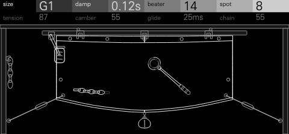
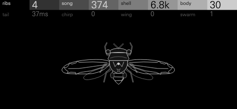
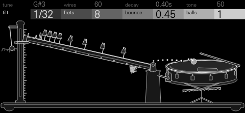
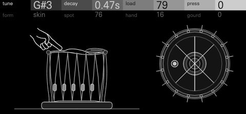

# Tetragon Suite

Four synthesis drum kits for the OP-XY, built with the
[Open-XY SDK](https://github.com/etcetc000/open-xy). Each one starts from
something odd in the physical world (a theatre thunder sheet, a Victorian
cabinet of curiosities, Galileo's inclined plane, the loaded head of a tabla)
and turns it into a full kit: 24 keys, each with its own sound, its own eight
controls and its own mixer channel, and a screen that draws the object you
are playing.

They are the drum kits to go with the
[Nonagon Suite](https://github.com/mmockett/OP-XY-Nonagon) and the
[Hexagon Suite](https://github.com/mmockett/OP-XY-Hexagon).

<table>
<tr>
<td width="50%"></td>
<td width="50%"></td>
</tr>
<tr>
<td></td>
<td></td>
</tr>
</table>

## The kits

| Kit | What it is |
| --- | --- |
| [**THUNDER**](thunder/README.md) | One theatre thunder sheet played every way a stagehand would (struck, flicked, snapped, bowed, shaken, strewn with chain), from a booming kick to a sizzling crash. |
| [**Curio**](curio/README.md) | A Victorian cabinet of sixteen sound specimens, from a ball dribbling to rest on a drum to lake ice singing as it cracks, each a drum with a small rhythm of its own inside the hit. |
| [**GALILEO**](galileo/README.md) | Galileo's inclined plane: every note rolls a ball down a board of frets onto a drum, cymbal or bar, so one key plays a flam, a ruff, a roll or a bounce that lands in time. |
| [**Syahi**](syahi/README.md) | One struck head, loaded like a tabla's and shaped into any drum, so a single control turns a kick into a slit drum, a bar or a gong. |

## Playing them

Load a kit on a drum track. Every key holds its own sound and eight controls
on two rows (press an encoder to switch rows), and the project saves them.
Hold **Shift** for the key's mixer channel: its sound, choke group, pan and
level on the first row; two settings of the kit's own and the key's FX I and
FX II sends on the second. Each kit comes with a default kit and a set of
kit presets for different styles, listed in its README with demos to listen
to.

## Building

The kits need the Open-XY SDK's per-key mixer channels
([etcetc000/open-xy#399](https://github.com/etcetc000/open-xy/pull/399)),
which is in review. Until it is merged and reaches the
[builder](https://open-xy.com), build them yourself against that pull
request's branch, `drum/pad-channel` on
[mmockett/open-xy](https://github.com/mmockett/open-xy/tree/drum/pad-channel).

Check the SDK out beside this repository and fetch its toolchain:

```sh
git clone -b drum/pad-channel https://github.com/mmockett/open-xy ../open-xy
(cd ../open-xy && python sdk.py toolchain fetch)
```

Then, from this repository:

```sh
python ../open-xy/sdk.py test --machine thunder --machine curio --machine galileo --machine syahi
python ../open-xy/sdk.py build --machine thunder --machine curio --machine galileo --machine syahi --stock-os <your stock-1.2.1>/os.ldr --layout <your last build's layout.json> --out <folder outside this checkout>
```

Install the build's `candidate/` files as the SDK's
[build guide](https://github.com/etcetc000/open-xy/blob/staging/docs/build.md#5-install)
describes. Pass your last build's `layout.json` so the machines already on
your OP-XY keep their numbers. A command-line build installs no presets: each
kit's `tools/presets.py` writes its kit presets into the build, as its README
describes.

## Licence

MIT ([LICENSE](LICENSE)).
