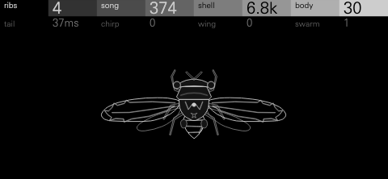

# Curio



A Victorian cabinet of curiosities as a drum kit. Each of its sixteen
specimens is one object from the bench and shelves behind a lecture on sound
around 1870, and each starts from something odd that really happens: a ball
dribbling to rest on a drum, lake ice singing as it cracks, a cicada's ribbed
tymbal buckling, a wine glass going flat as it fills, a bell falling silent
as the air is pumped out of its jar. They are filed in four drawers, THUMP,
CRACK, TICK and RING, and every key of the OP-XY's 24 can hold any of them,
with all eight of its controls, its own pan, level and sends, and two
settings of its own: TUNE and VARY.

The kit plays as a drum kit, not a physics demo. BALL goes from a tight kick
to a kick with its own ghost note to an 808 boom; CICADA from a tick to a
closed or open hat to a swarm; SHEET from an iron snare to a crash to a
thunder roll; GLASS from a ping to a bowed swell. Bounces, shards, teeth,
drips and rib trains give a single hit its own small rhythm, the detail a
sampled kit needs flams and rolls for.

## Origin

The Royal Institution's lectures on sound in the 1860s and 70s were
demonstrations: John Tyndall rang bells in jars as the air was drawn out,
sang into flames and made sand dance on plates. Curio imagines the cabinet
those lectures were stocked from. Every specimen is a real phenomenon, drawn
as the object that makes it and synthesized from its physics: Minnaert's
singing bubble for DRIP (1933), the dispersive "pew" of flexural waves in
lake ice, a Helmholtz resonator in a cask's head space, the stick-slip
squeal of chalk on slate, Boyle's bell in vacuo (1660).

## The specimens

| Drawer | Specimen | What it is | Plays as |
| --- | --- | --- | --- |
| THUMP | **ball** | A ball dropped from a retort clamp onto a stretched hide, bouncing to rest | kick, ghost-noted kick, 808 boom, dribble |
| THUMP | **cask** | A knuckle on a cooper's cask; the air above the liquid booms | boom, toms, wooden knock |
| THUMP | **stone** | A ringing stone, a lithophone, struck with a mallet | tuned stone toms, marimba-like tones |
| THUMP | **drip** | A drop trapping a bubble that sings upward, over a basin | water percussion, rising blips |
| CRACK | **ice** | Lake ice cracking under load, then its dispersive chirp | snare, crackle, "pew" effect |
| CRACK | **sheet** | A thunder sheet, struck and shaken | iron snare, crash, thunder roll |
| CRACK | **spark** | A Leyden jar discharging across a spark gap | clap, zap |
| CRACK | **cork** | A cork drawn from a bottle | rim, pop, fizz |
| TICK | **cicada** | A cicada's tymbal buckling rib by rib | closed, pedal and open hats, shaker swarm |
| TICK | **ratchet** | A watchman's rattle: a toothed wheel flicking a slat | clicks, rattle |
| TICK | **pod** | A dried seed pod shaken in the hand | shaker |
| TICK | **match** | A match struck: the scrape, then the flare | brush |
| RING | **glass** | A struck wine glass, detuned by its water | ping, bell, bowed swell |
| RING | **bell** | Boyle's bell in a jar as the air is pumped out (BELL JAR) | cowbell, electric bell, ghost bell |
| RING | **chalk** | Chalk squealing on a slate | cuíca-like squeak, scratch |
| RING | **roar** | A bull-roarer whirled on its cord | pitched drone hit, whoosh, riser |

The default kit puts kicks low, then snares and claps, hats, toms in the
middle, and percussion and effects at the top: 1 ball (kick), 2 cask (boom),
3 ice (snare), 4 cork (rim), 5 spark (clap), 6 sheet (iron snare), 7 cicada
(closed hat), 8 cask (low tom), 9 cicada (pedal hat), 10 cask (mid tom),
11 cicada (open hat), 12 cask (high tom), 13 pod (shaker), 14 ratchet,
15 glass, 16 bell (cowbell), 17 stone (low), 18 match (brush), 19 stone
(high), 20 sheet (crash with thunder), 21 drip, 22 chalk, 23 roar, 24 ice
("pew": thick, all tone, with the far shore's echoes).

## Controls

Each key has two rows of four, stacked in the header; press any encoder to
switch rows. Values read 0 / 50 / 100 across each control's travel, with the
specimen's design default in brackets; captions in hertz, seconds or counts
are the engine's own figures. Every control changes its sound across its
whole travel and moves a part of the specimen on screen.
[docs/sheet-controls-*.png](docs) show every control at 0, 50 and 100 at 1:1.

| Specimen | First row | Second row |
| --- | --- | --- |
| ball | **drop** 0/50/100 (55): drop height: punch, the sweep's depth, the first bounce's gap · **bounce** (30): one dead thump to a dribble of a dozen · **skin** 30Hz/60Hz/119 (53Hz) · **ball** (34): felt, rubber, then steel with a ping | **decay** 60ms/0.42s/1.2s (0.11s) · **floor** (20): a crate under the drum, dry to a stage boom · **spot** (0): centre to edge, round to a tom-like knock · **grit** (0): a snare chain on the skin |
| cask | **size** 40Hz/88Hz/196 (69Hz): the air's note · **fill** (30): empty and booming to full and short · **knock** (45): the knuckle, soft to hard · **stave** (30): the staves' knock | **bung** (20): the note bends down · **hoop** (0): the iron hoops ring · **slosh** (0): the liquid wobbles the note · **cellar** (0): the cellar's echoes |
| stone | **pitch** 109/311/879 (203) · **mallet** (45): felt to hard · **rock** (40): stretches the modes · **ring** 0.12s/0.69s/1.7s (0.60s) | **chip** (30): the chip's click · **stack** (0): a second stone on top · **dull** (30): a damp cloth, shorter and duller · **dust** (0): grit patter after |
| drip | **size** (64): small and high to large and low (1980 to 350 Hz) · **rise** (45): how far the bubble's note climbs · **basin** (30): the basin rings · **tap** 1/3/5 (1): drops a hit | **depth** (34): the bubble's ring · **splash** (25) · **wobble** (0): the bubble flutters · **echo** (20): the tiled room |
| ice | **load** (55): soft tick to a hard, driven crack · **sheet** (40): thin, high, fast to thick, deep, slow · **shards** 1/4/7 (2): one crack to a crackle · **tone** (34): noise snare to singing chirp | **ring** 50ms/0.18s/0.30s (0.14s) · **cold** (50): warm to crisp, with a crunch of micro-cracks · **lake** (50): the body's thump · **spread** (0): the far shore's "pew-pew" |
| sheet | **size** (50): small to large (130 to 42 Hz) · **shake** (0): one strike to a long wash · **rattle** (45): the frame's buzz · **hang** 0.15s/1.2s/3.3s (0.30s) | **thunder** (0): a low rumble with a throb · **metal** (50): dull iron to bright brass · **beater** (40): soft mallet to iron rod · **roll** 0/4/8 (0): a roll of strokes |
| spark | **charge** (40): cracks and their snap · **gap** 4ms/12ms/20ms (10ms): between cracks · **jar** 700/2.0k/3.3k (1.6k): the crack's band · **ozone** (10): the hiss after | **arc** (0): the arc's 120 Hz buzz · **scatter** (20): more, looser cracks · **body** (0): a thump of the base · **dist** (0): far away, darker and later |
| cork | **neck** 350/800/1.2k (708): the pop's note · **pop** (50): its bend and strength · **fizz** (15) · **bottle** (30): a body under the pop | **thock** (40): the cork's knock · **squeak** (0): the twist before · **spill** (20): the fizz's spray · **glug** (0): glugs after |
| cicada | **ribs** 1/11/31 (4): tick, closed hat, open hat · **song** 120/339/959 (374): clicks a second · **shell** 3.5k/6.1k/11k (6.8k) · **body** (30): noise to metallic ring | **tail** 12ms/0.14s/0.41s (37ms): closed to open · **chirp** (0): the train falls up to 1.2 octaves · **wing** (0): a wing's whoosh · **swarm** 1/3/5 (1): cicadas |
| ratchet | **teeth** 1/8/15 (3) · **crank** 10Hz/45Hz/79Hz (45Hz): teeth a second · **slat** 900/2.5k/4.0k (2.5k) · **wood** (40): long to short ring | **slow** (0): a ritardando, up to four times the first gap · **spring** (0): a spring's ting · **box** (20): the box's knock · **wear** (0): uneven, late teeth |
| pod | **seeds** (45): how many · **shake** (30): a flick to a long shake · **shell** 1.8k/4.3k/6.8k (4.3k) · **size** (40): a bigger, lower, broader pod | **dry** (0): brittle and bright · **tilt** (0): a second rush of seeds · **swish** (20): the husk's swish · **scatter** (0): stragglers after |
| match | **scrape** (50): the head on the striker · **flare** (40): the flame's size and length · **head** 2.0k/4.0k/6.0k (3.6k): the scrape's pitch · **draw** 20ms/70ms/0.12s (50ms) | **phos** (20): the phosphorus crackling · **wood** (0): the wood's low roar · **hiss** (40): the flame's band · **puff** (0): a puff of breath |
| glass | **water** (34): empty to full, about 40% lower and damped · **strike** (45): fingertip, spoon, glass rod · **ring** 0.35s/1.8s/4.3s (1.5s) · **rim** (50): thin crystal to thick goblet (1500 to 494 Hz) | **rub** (0): a wet finger's swell · **slosh** (20): the water's vibrato · **crack** (0): the doublets spread into a buzz · **chink** (0): a second glass a major third up |
| bell | **strokes** 1/6/11 (1): one to a ringing electric bell · **bell** 449/839/1.6k (784) · **air** (10): the jar pumped out: fainter, shorter, all hammer · **hammer** (25) | **ring** 80ms/0.61s/1.5s (0.68s) · **gong** (0): bell to gong partials · **jar** (0): the jar's hum · **base** (0): the plate's knock |
| chalk | **pitch** 500/1.2k/2.8k (997) · **press** (40): a soft squeak to a hard sawtooth squeal · **slate** 1.5k/3.3k/5.0k (3.3k) · **glide** (30): the pitch climbs | **length** 30ms/0.18s/0.33s (0.11s) · **grit** (0) · **chatter** (0): the stroke stutters · **dust** (0) |
| roar | **whirl** 2Hz/9Hz/15Hz (6Hz): turns a second · **size** (50): small and high to large and low · **cord** (40): the swing of its pitch · **swell** 20ms/0.32s/0.62s (0.20s) | **length** 0.30s/1.4s/2.5s (0.95s) · **throb** (59): the pulse of its turns · **buzz** (30): the slat's flutter, three octaves under its hum · **wind** (0): the rush of air |

### Shift

Hold Shift and the header shows the key's mixer channel on the row the
encoders are on, as stock's Drumline does; a press of an encoder switches the
row with Shift still held.

| Row | Encoder 1 | Encoder 2 | Encoder 3 | Encoder 4 |
| --- | --- | --- | --- | --- |
| First | **specimen**: the drawer as the title, the specimen as the value (`thump` over `ball`; three long names are shortened to fit: `cicda`, `rtcht`, `mtch`) | **choke**: none, 1, 2, 3 | **pan**: -100..100 | **level**: -30..0 dB |
| Second | **tune**: -16..+15 semitones (`-5st`) | **vary**: 0..15 | **fx i**: TRK, then 0..100 | **fx ii**: TRK, then 0..100 |

- **TUNE** moves every pitch of the specimen by up to 15 semitones, so one
  specimen plays toms or a tuned scale across keys.
- **VARY** makes each hit a slightly different specimen: every control moves
  by up to a tenth of its travel, the pitch by up to 0.4 semitone and the
  level down by up to a quarter, at 15. 0 is every hit the same.
- **FX I** and **FX II** are the key's own sends: TRK follows the track's.

## Presets

`tools/presets.py --out <folder>` writes the kits as OP-XY presets
(`curio/default.json` and one per kit). Each key keeps its specimen and
controls, and its own pan, level, TUNE, VARY and two sends.

| Preset | Role | The kit |
| --- | --- | --- |
| **cabinet** | The default: all-round | The keys above |
| **cellar** | Dusty boom bap, 90-100 BPM | A soft felt ball with a ghost bounce, a wet ice snare with a deep lake, cork rims, a dark cicada, a glass a fourth down; panned, levelled, varied, the snare and glass sent to FX II |
| **foundry** | Industrial techno, 124+ | A steel ball with no bounce and grit, a spark and sheet clap stack, open cicadas, ratchet 16ths, a bell half pumped out, a roar riser |
| **frost** | UK garage, 2-step | A crisp, cold ice, chirping cicada hats, a high cork, stone toms |
| **hothouse** | Glitch and IDM | Drip rolls, a cicada swarm, chalk squeaks, a worn ratchet, cork fizz |
| **glasshouse** | Tuned percussion | Glass, stone and bell up pentatonic scales by TUNE, spread across the stereo field, a light kick, a shaker |
| **parlour** | Brushes and acoustic | Match brushes with a long draw, pods, a soft knuckle on the cask, stone |
| **storm** | Cinematic | A dribbling ball boom, sheet thunder rolls, the roar, an ice "pew" with spread, a bell at full vacuum, all deep in the sends |

## Demos

Rendered from the engine (`tools/demos.py`) as stereo 44.1 kHz MP3s, each key
at its kit's own pan and level, with no effects or other processing, and each
file normalised to -16 LUFS integrated (BS.1770) unless a peak would pass
-1 dBFS first:

- [docs/demo-hits.mp3](docs/demo-hits.mp3): every specimen's default hit, drawer by drawer.
- [docs/demo-cellar.mp3](docs/demo-cellar.mp3): the cellar kit, boom bap at 98 BPM.
- [docs/demo-foundry.mp3](docs/demo-foundry.mp3): the foundry kit, techno at 124 BPM.

## How it works

Every specimen is synthesized from its physics in fixed point: Q28 signals,
Q31 gains, pitches as log2 of hertz, no floating point, no 64-bit arithmetic
and no division in any sample loop (`dsp.h`).

- **Struck things ring as modes.** Stone bars, staves, hoops, basins, the
  slat, the bell, the second glass and the thunder sheet are two-pole
  resonators, struck by setting their state. A delayed strike adds exactly
  as a real echo would, so the cellar, the tiled room and the far shore are
  re-strikes, not delay lines: Curio keeps no audio buffer at all.
- **Swept things are oscillators.** The ball's skin, the cask's air, the
  drip's bubble, the ice's chirp and the cork's neck are sines whose pitch
  glides: the ball's falls from a blow, the bubble's rises (Minnaert), the
  ice's falls as 1 / (1 + t / tc)², as flexural waves arrive high notes first.
- **Noise is shaped by bands** with no response at 0 Hz, normalized to unit
  loudness, and particle sounds (seeds, fizz, scrape, crackle) are random
  impulses through resonators, scaled by their expected peak.
- **The ice** cracks in spiky noise, its
  surface crunches with micro-cracks, and a band of noise rides the newest
  chirp while it is loud, so the "pew" sounds of ice, not a laser. Load
  drives the crack and the chirps, while the lake and the surface stay clean
  beneath them, so the snare's crack stands out of its body. Two chirps
  sound at once (a third rarely showed over them). **The spark** claps three
  to six times, each crack with a shock's snap and a ping of the jar's glass,
  over a short ozone tail (its default clap falls 30 dB in about 120 ms,
  where MD KIT's claps take 48 to 140). **The sheet** gets a cascade of hiss as its
  energy climbs into high modes, and twelve modes, each weighted for those
  it stands for; its blow is the same noise every hit, so a struck sheet is
  as loud each time.
  **The cicada's** sizzle is one band of noise sliding down with the train
  driven into a soft clip; it carries the
  hats under soft ticks, so an open hat rings on where a closed one stops,
  and the hats sit with the rest of the kit: the closed hat at -19.0 LUFS-M
  under the ceiling (below), the pedal hat at -19.5 and the open hat at
  -18.2 (MD KIT's -16.3, -20.7 and -11.2 in the same measure).
- **Pitched where it can be.** The chalk's squeal falls away like a cuíca's
  note, and the roar hums at the pitch of its band, its flutter three
  octaves under it, so both follow TUNE as notes, not only as effects.
- **Quiet parts cost nothing.** An attack, a blip, a click or a band that has
  died away, or a part whose control is at 0, stops running until the next
  strike.
- **Gestures inside a hit** (bounces, shards, teeth, drips, strokes, echoes)
  run in milliseconds, not note lengths: a drum kit's `render` has no tempo.
  They are short ornaments that keep their own time: the tap drips steadily,
  100 to 55 ms apart, the sheet's roll strikes every 75 ms, the bounces
  shorten as a real ball's do. For rolls in the song's time use the
  sequencer's step repeats. The ratchet's slowing is capped at four times
  its first gap, and no gesture runs past about a second and a half.
- **Levels: loud and even.** Measured as the ear weights a hit (BS.1770's
  K-weighting over its loudest 400 ms, LUFS-M, in dB under the SDK's
  half-scale ceiling), each specimen's default hit sounds at its role's
  level: the ball's kick and the cask's booms and toms at -16.5, everything
  else at -19, a little louder than MD KIT's kit in the same measure (its
  loudest kick -17.7, snares -21.4, claps -21.5 to -22.9, cowbells -22.2 to
  -23.6). `tools/calibrate.py` sets each specimen's gain from the real
  engine, and a trim at each control's 0, 32, 64, 96 and 127 that makes up
  three quarters of the loudness the control moves, so turning a control
  changes a hit's tone more than its level, and a kit's keys sit together
  with their LEVEL at or near 0 dB (`levels.h`). A peak limiter at the output sees each block before
  it plays, so it needs no delay: it holds every sample to 0.42 of full
  scale (-1.5 dB under the ceiling), lower (to -2.2 to -3.9 dB) for the
  cask, the stone, the ice, the cork, the ratchet and the bell jar, whose
  sharp strikes' true peaks run over their samples, so a default hit's true
  peak stays 1 dB under the ceiling.
  At the defaults it takes at most 3 dB off a hit's first milliseconds
  (the ball 1.6, the cask 0.7, the cork 2.7, the spark 1.6, the ice, the
  sheet, the stone, the ratchet and the bell jar 3), and nothing off the
  drip, the cicada, the pod, the match, the glass, the chalk or the roar; it
  recovers about 1 dB every 1.5 ms. A soft knee from 0.44 behind it keeps
  every voice under half scale whatever its controls. Every specimen's
  defaults land within 1.6 dB of their level (the stone and the ratchet
  1.6 and 1.1 under, held by the limiter's 3 dB). A short tink, the default
  kit's bell-jar cowbell, measures 5 dB under: a 60 ms hit reads low over
  400 ms, and its strike already reaches the limiter.
- **Voices end.** Once a voice stays under -84 dB for 90 ms with nothing
  still to come, it renders silence and `finished` frees it.

## Screen

The selected key's specimen alone on black, large, in fine bright outline
and centred under the header. Its lines are thin, as on stock's Drumline: an
outline draws 1 px, a line about 1.5 px across, and everything round in life
is drawn in smooth curves. Every control moves a
real part of the specimen (the clamp rises with drop, the cask's liquid with
fill, the stone's felt cords slide to its nodes with ring, the cicada's wings
open with wing), and a hit makes it do its thing: the ball drops and bounces
on the dented skin, the mallet swings, the drop falls and the basin ripples,
the pendulum strikes and the water shivers, the cork pops out at a slant, a spark jumps
the gap between the brass knobs, the thunder sheet flexes on its chains,
the match slides along the striker, the bull-roarer flies round its orbit,
the cicada's wings flick.

- **A hit's motion lasts as long as its sound**, reckoned from the
  specimen's own decay controls. A drum kit's voices play until their sound
  ends: the drum renderer applies neither the track's amp envelope nor
  note-off, so the screen follows neither.
- **Only the selected key's notes animate it.**
- **Each object is drawn as it is built and held:** the ball's retort stand with its boss and thumbscrew over
  a rope-tensioned drum; a cooper's cask with its hoops, spigot and stillage
  under a cellar's vault; a lithophone bar on felt cords over a sounding
  box, as large on the screen as the cicada; a swan-neck tap over a deep
  pedestal basin, the bubble rising through it as a column, the tiled wall
  rising behind it with the room's echo; a slab of lake ice
  on sawhorses under a cast-iron weight, frost crystals blooming on it as it
  gets colder, the ice tongs open on their hook; a Leyden jar
  wired to a spark gap of brass knobs on glass pillars, a gold-leaf
  electroscope and an induction coil; a thunder sheet on chains from its
  beam with a turned handle at its foot; a Bordeaux bottle with its capsule;
  a cicada pinned in dorsal view with veined
  wings and six legs; a cranked watchman's rattle; a poppy head in a
  specimen clip; a matchbox with its tray drawn out, three rows of matches
  lying in it, heads to the end, and a match on the striker; a cut goblet
  beside a brass pendulum stand; an electric bell, its magnet and a
  Leclanché cell under a jar on the pump plate; a slate in a pegged frame; a
  long carved bull-roarer on its cord from a lashed stick.
- **Nothing enters the header or leaves the screen.** Every part of every
  specimen, moving or still, at any setting, stays below the header and on
  the screen.
- **At rest nothing moves.**

[docs/sheet-specimens.png](docs/sheet-specimens.png) shows every specimen
with all its controls at 0, 50 and 100, at its defaults and mid-hit;
[docs/sheet-screens.png](docs/sheet-screens.png) eight of them mid-hit;
[docs/sheet-shift.png](docs/sheet-shift.png) both Shift rows.

## CPU

On a computer, the SDK's estimate
(`tools/cpu.py`, each specimen at its heaviest setting) puts one voice at
about 1.3% of the audio block (chalk) to 2.3% (ball), with the ice at 2.2%.
The thunder sheet is the heaviest, about 5%, with its hang or its roll at the
top, when all twelve of its modes ring at once. For scale, MD KIT's heaviest
voice measures 3.085% on the device (its catalog record, v1.2.2). A computer
ranks engines differently from the OP-XY's processor, though: the same
estimate puts that MD KIT voice at 0.86%, so take these figures as a guide.

**Memory.** `sdk.py test --firmware` compiles Curio in 166.5 KiB of the shared
2032 KiB: a voice is 1,128 bytes (16 voices and a spare: about 18.7 KiB), the
display state 80 bytes, and the sine, log2, 2^x and tanh tables about 10 KiB.

## Files

| File | What it is |
| --- | --- |
| `kit.h` | The cabinet: specimens, labels, captions, the default kit |
| `dsp.h`, `tables.h` | The fixed-point toolkit; tables written by `tools/make_tables.py` |
| `thump.h`, `crack.h`, `tick.h`, `ring.h` | The four drawers' specimens |
| `core.h`, `engine.cpp` | The voice, TUNE and VARY, the levels, the peak limiter and soft knee, `finished` |
| `levels.h` | Written by `tools/calibrate.py`: each specimen's gain, peak limit and control trims |
| `display.h`, `display.cpp` | The screen |
| `panel.svg.fragment`, `art.h` | Written by `tools/make_panel.py`: the artwork and each part's moves |
| `tests/sound.cpp`, `tests/screen.cpp`, `tests/header.cpp`, `tests/clear.cpp` (with `tests/bounds.h`, written by `tools/make_panel.py`) | Run by `sdk.py test` |
| `tools/presets.py` | The kit presets |
| `tools/cpu.py`, `tools/cpu_ratio.cpp` | The CPU estimates (alone; against MD KIT's heaviest voice) |
| `tools/calibrate.py`, `tools/hit.cpp` | The levels (`levels.h`) |
| `tools/demos.py`, `tools/render.cpp` | The demos |
| `tools/sheet.py`, `tools/frames.cpp` | The contact sheets, from the real display code |

## Building

```sh
PY=<open-xy checkout>/.venv/bin/python
$PY <sdk>/sdk.py test --machine curio --cxx "$(brew --prefix llvm)/bin/clang++"
$PY <sdk>/sdk.py test --machine curio --firmware
python3 tools/compilers.py --sdk <sdk>                                  # tests under clang, g++ and sanitizers; renders bit for bit alike
python3 tools/sheet.py --sdk <sdk> --font <UniversNextPro-Light.ttf>   # contact sheets, screen.png (--each: every specimen alone)
$PY tools/demos.py --sdk <sdk>                                           # demos
python3 tools/presets.py --out <build>/candidate/content/presets         # presets
```

Curio needs SDK 1.10 (`padMix`, `padControls`). The screen's face is stock
OP-XY content, so it is not in this repository: pass it with `--font` or
`XY_FONT`.

## Licence

MIT. Curio is written from its physics; no code, tables or constants from
any other instrument.
