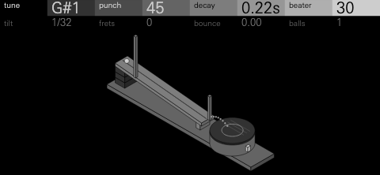
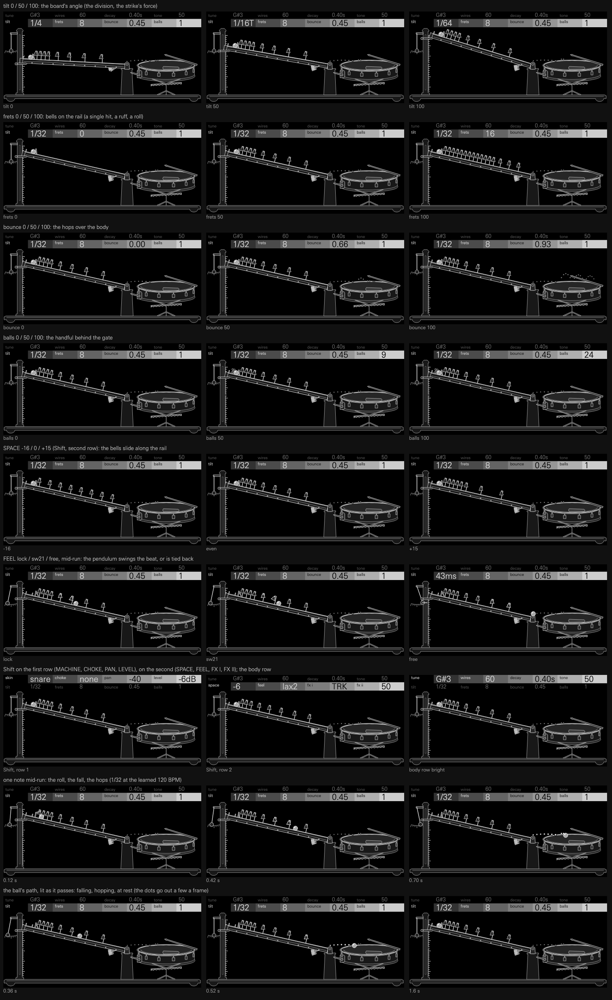

# GALILEO



A drum kit with motion inside the hit. Every key of GALILEO is one of
Galileo's inclined planes: a note releases a ball, or a handful of them, down
a grooved board. The ball rings the frets hung over the groove, falls onto
the key's body (a drum, a cymbal, a bar, a block) and bounces to rest. So one
note can be a crisp hit, a flam, a drag, a ruff, a roll that swells into its
accent, a bouncing ball, or a handful of shot that becomes a shaker. With the
frets locked to the beat, the run lands in time.

**Origin:** around 1604 Galileo rolled a bronze ball down a grooved board to
find out how things fall. He had no clock fine enough, so he used his ear. As
Stillman Drake read his notes, gut frets were tied across the groove, and the
ball bumped over each one. He moved the frets until the bumps fell in time
with a tune he sang. The frets then sat at distances of 1, 4, 9, 16, the odd
numbers added up. Later demonstration planes hung little bells instead. The
ball keeps an even beat by speeding up into wider and wider gaps. At the foot
it falls onto something and bounces to rest, the gaps between bounces
shrinking towards nothing: Zeno's bouncing ball, at rest in finite time.

## How it plays

Each key holds one of fifteen models and its eight controls, which the
OP-XY saves with the project. The encoders' first row shapes the body; the
second, the same on every model, shapes the motion. A press of any encoder
switches rows. Shift and the encoders give each key its own mixer channel:
on the first row its model, choke group, pan and level, on the second its
frets' spacing, its feel and its own FX I and FX II sends.

| Encoder | First row (the body) | Second row (the motion) |
| --- | --- | --- |
| 1 | tune (or tone) | tilt |
| 2 | the model's own | frets |
| 3 | the model's own | bounce |
| 4 | the model's own | balls |

| Encoder | Shift, first row | Shift, second row |
| --- | --- | --- |
| 1 | MACHINE: the model, under its group (SKIN, METAL or PERC) | SPACE: the frets' spacing, `-16` .. `even` .. `+15` |
| 2 | CHOKE: none or 1..3 | FEEL: `lock`, swing `sw8` .. `sw33`, looseness `lax1` .. `lax12`, `free` |
| 3 | PAN: -100 .. 100 | FX I: `TRK` (the track's send) or the key's own 0 .. 100 |
| 4 | LEVEL: -30 .. 0 dB | FX II: the same |

A note on a key cuts that key's last note (chokeSameKey), as a drum
machine's track does: one ball per key at a time, however fast it repeats.

### The motion

| Control | What it does |
| --- | --- |
| tilt | The board's angle, 3 to 17 degrees. With FEEL on `lock` each eighth of its travel is a division of the beat the frets fall on: 1/4, 1/8, 1/8T, 1/16, 1/16T, 1/32, 1/32T, 1/64. On `free` it is a time, 300 ms (level) to 18 ms (steep). A steeper plane also strikes the body harder: the landing runs from -6 dB, a soft stroke, to full force, and harder is brighter. The frets don't follow it: a roll's loudness is its own, the same at 1/16 as at 1/64, so a fast roll is no louder than a slow one. |
| frets | Bells over the groove before the landing, 0 to 16. 0 is one hit, 1 a grace note, 2 a drag, 3 a ruff, 4 to 16 a roll that swells into the accent. The roll's strokes are softer the faster they come, by the square root of their period, so the body doesn't pile up. Two hands play it: every second stroke is a little softer and later, and each stroke moves a little at random, up to 5% of the period (at most 2 ms) and 10% in force, the same on every note of a key. |
| bounce | Restitution, 0 to 0.93: the rebounds after the landing. The first flies 2 x the division (at least 30 ms) x e, each next one e times shorter and softer, until it is under 2.5 ms or -32 dB. At 0.5 the first rebound falls on the next division. Each hop's restitution varies by up to 3%, as a real ball's does. |
| balls | The handful, 1 to 24. Two are a flam 23 ms apart; three to five a clap or a ruffle; more a cloud of shot spread over 23 ms x (balls - 1)^0.55, 130 ms for 24. Each ball has its own weight and a slightly different restitution, so their tails come apart. |

Measured at the snare's defaults (1/32, 120 BPM), from `tools/catalog.py` and `motion.h`:

| Control | 0 | 25 | 50 | 75 | 100 |
| --- | --- | --- | --- | --- | --- |
| tilt: the division (locked) | 1/4 | 1/8T | 1/16T | 1/32 | 1/64 |
| tilt: the period (free) | 300 ms | 148 ms | 73 ms | 37 ms | 18 ms |
| tilt: the landing's force | -6 dB | -4.5 dB | -3 dB | -1.5 dB | 0 dB |
| frets | 0 | 4 | 8 | 12 | 16 |
| bounce: restitution | 0 | 0.47 | 0.66 | 0.80 | 0.93 |
| bounce: rebounds, and how long they take | none | 4, 0.11 s | 7, 0.24 s | 15, 0.50 s | 44, 1.61 s |
| balls: the handful, and its spread | 1 | 4, 42 ms | 9, 72 ms | 15, 98 ms | 24, 129 ms |

**SPACE** sets the exponent k of the frets' places, x ~ i^k. At `even` (k = 2)
they sit at Galileo's 1, 4, 9, 16, and the ball, speeding up, rings them at
even times. At `-16` (k = 1) they are evenly spaced, so the taps speed up as
the ball does: an accelerando. At `+15` (k = 2.9) they spread out and the run
slows into its landing, like a drag. **FEEL** swings odd frets late by up to a
third of a division, or lets each fret and landing fall up to 12 ms late at
random, or frees tilt from the beat.

## The models

Fifteen bodies in three groups. Defaults have no motion on the single hits;
FILL, BELL, TINE, CLOCK and RATCHET default to a short run and CLAP and
SHAKER to a handful, so that what they do with a run is heard at their
defaults. Every control moves the sound across its whole travel at the
others' defaults (`tools/sweep.py` measures every one at nine steps;
`tests/sound.cpp` checks both ends).

| Model | tune / tone | 2 | 3 | 4 |
| --- | --- | --- | --- | --- |
| **SKIN** | | | | |
| kick | tune 38 to 90 Hz | punch: the strike's pitch drop, none to 3 octaves falling over 12 to 22 ms, and its knock, thump and click from -10 to +6 dB | decay 35 ms to 1.5 s: short and punchy over its lower half (0.37 s to -40 dB at its default), a long boom at the top | beater: a felt thump (2.5 ms, dull, its knock low) to a plastic click (0.15 ms, bright, its knock high) |
| snare | tune 150 to 320 Hz | wires: the head alone to mostly rattle; the wires buzz with the head's swing | decay 50 to 300 ms | tone: dark wires (their band at 1.4 kHz) to a bright crack with ring (4.5 kHz) |
| tom | tune 62 to 285 Hz | decay 0.12 to 1 s | bend: the strike's pitch drop, 25 to 115% | skin: felt-muffled to open overtones |
| fill | tune: the lowest head | decay | spread: 1.5 to 5 semitones between heads; each fret is the next head up the rack | skin |
| hand | tune 170 to 420 Hz | slap: an open tone to a slap's crack | decay 60 to 560 ms | mute: open to palm-muted, shorter and higher |
| rim | tune 0.7 to 2.1 kHz | wood: a metal ring to a woody side-stick | decay 12 to 110 ms | body: the shell under the click |
| **METAL** | | | | |
| hat | tune: the metal 310 to 620 Hz, its band with it | decay: closed 28 ms to open 0.7 s, softer as it opens | tone: the band 4.2 to 7.2 kHz | metal: hiss to clang |
| ride | tune | decay 0.55 to 4.4 s | bell: no ping to a bell | wash: a dry ping to shimmer |
| bell | tune 0.5 to 1.2 kHz | decay 50 to 650 ms | pair: one bell to an agogo pair, its strikes alternating, 1 to 7 semitones apart | metal: pure to clanky |
| tine | tune 330 Hz to 1 kHz | decay 0.25 to 2.5 s | step: repeats one bar to leaps of 4 pentatonic steps a fret | hard: a yarn to a brass mallet |
| clock | tune: the tick 1.7 to 3.9 kHz | decay 6 to 250 ms | tock: 3 to 19 semitones under the tick | case: a dry tick to a resonant case |
| **PERC** | | | | |
| block | tune 0.6 to 1.8 kHz | decay | hollow: clave to woodblock to slit log | click: a knuckle's knock to a stick's hard click |
| clap | tone: the palms' cavity 0.9 to 2.1 kHz | decay: the room's tail 30 to 380 ms | room: dry to early reflections at 11, 19 and 31 ms | snap: a soft hand to a sharp one |
| shot | tone: the shell 3 to 9 kHz | decay: the rustle, 15 to 400 ms | shell: a husky gourd to a ringing cabasa | grit: fine sand (0.3 ms grains) to coarse shot (8 ms) |
| rattle | tune 0.9 to 2.4 kHz | decay | teeth: one click a fret to a 12-tooth scrape (a guiro) | wood: a metal pawl to a wooden ratchet |

The header shows each value in real units: a tune as a note (`G#3`), a tone
as a frequency (`1.2k`), a decay as a time (`85ms`, `0.41s`), tilt as its
division or period, frets and balls as counts, bounce as its restitution.

## Kit presets

Eight kits, each a different role. Each preset sets every key's model and
eight controls, and its own mixer channel: its SPACE, FEEL and sends, carried
in the top half of the pad word that stock's preset writer exports, and its
pan and level (`tools/presets.py`; `--check` decodes every key back through
the SDK's own storage code). The kits pan their hats, hands and shakers, swing
or loosen what should breathe, and send rides, bells and tines to FX II.

| Kit | Role | What it shows |
| --- | --- | --- |
| **Galileo** (the default) | all-rounder | kick, a kick that rebounds on the next 1/16, snare and its flam, drag and a roll into the accent, rim, clap, hats with a one-note roll, toms, the shaker, ride, fill, bell, block, hands, a tine run, the rattle, the clock, a ride settling like a coin |
| **Clockwork** | trap and hip hop | an 808-style kick whose rebound lands on the 1/16; hat rolls at 1/32, 1/32T and 1/64 from single notes; a four-hand clap; a bouncing rim |
| **Rudiments** | marching and drumline | snares as flam, drag, ruff, five-stroke, six-stroke and press roll; the fill as tenor drums; unison bass drums |
| **Workshop** | broken beat and acoustic funk | ghost drags; quarter notes turned into strokes of shot; a tick-tock clock; a marble tine; a rack fill |
| **Marble Run** | melodic and IDM | tine and block runs down a pentatonic scale; bell pairs; long tines |
| **Shot and Skin** | Afro-Latin percussion | conga and bongo with ghost bounces; shaker, cabasa and guiro; agogo pairs; clave and woodblock |
| **Zeno** | texture and ambient | long bounces; rides settling like coins; free-running rattles |
| **Escapement** | techno and industrial | a dry kick; rattles and clocks as hats; metal bounces |

Hear them: [the default kit, key by key](docs/demo-hits.mp3), [the motion
row at work](docs/demo-motion.mp3), and two grooves,
[Clockwork at 120 BPM](docs/demo-clockwork.mp3) and
[Workshop at 104 BPM](docs/demo-workshop.mp3). All four are rendered by the
engine itself on a computer, in stereo at each key's own pan and level, with
no effects, each normalised to -16 LUFS integrated, or to a -1 dBFS peak where
that is lower.

**Levels.** Every model's default key is set to a loudness, not a peak: the
loudest 400 ms, K-weighted (BS.1770's momentary loudness), the Tetragon kits'
common targets of -16.5 dB under the SDK's half-scale ceiling for the kicks, the
toms and the tenor fill, and -19 dB for everything else (`tools/calibrate.py`).
That is as loud as MD KIT's loudest kick and 2 to 4 dB over its snares, claps
and cowbells. No default key peaks over 0.42 of full scale, where the kit's soft
ceiling starts to bend, or within 1 dB of the ceiling between samples. Each body
control carries a loudness trim along its travel, so a key sounds about as loud
whatever its tune, decay or tone, held lower where a short, peaky hit would
otherwise be limited. The snare and the clap take about 1.5 dB off their first
milliseconds through a soft knee of their own, the shaker about 3 dB off its
loudest grains and the block about 2 dB off its click; the block still sits
about 3.5 dB under the others, held there by its click, a burst of noise whose
peaks between samples run about 3 dB over the samples themselves. An open hat
plays its strike about 7 dB under a closed one's, so the two sit level by ear.
Each kit preset cuts a key that sounds over its target at its own settings with
the key's LEVEL (`tools/balance.py`); in the default kit only the keys more
than 0.75 dB over are cut (the flam and the roll by 1 dB, the coin settling by
4), the rest at 0 dB. Most keys of every kit sit within 1.5 dB of their
target; the quieter ones are the slowest landings (a key on 1/8 or 1/4 strikes
softer, as TILT does), the block's clicks, and Marble Run's soft, long tines.

**The amp envelope.** A drum kit's voice on the OP-XY plays until its own
sound ends: the OS applies neither the M2 amp envelope nor a note-off to a
kit, so a run or a bounce always plays out, and the kit frees each voice
itself once it has rung out. Only the next note on the key or its choke
group cuts it.

## Tempo

On SDK 1.10, a drum kit's audio gets no tempo, and neither does its screen.
GALILEO learns the beat from its own notes. A clock that its voices move on
as they render times every note's start. The gaps between notes, across all
its keys and tracks, refine an estimate of the sixteenth, which starts at
120 BPM:

- a gap counts when it is 1 to 16 sixteenths within 12%, and pulls the
  estimate a quarter of the way;
- gaps under 40 ms are chords and flams, and are skipped;
- gaps quicker than a sixteenth that are a half, a third or a quarter of it
  are fills and triplets, and change nothing; nor does a single stray note;
- only when five of the last eight gaps fit nothing, across at least two
  bars, is the beat searched for again among them (a new tempo is followed
  within a few bars);
- a gap across a silence doesn't count, because the clock stops while
  nothing sounds; the newest note's voice keeps it running for 2.5 s after
  its sound ends, so a sparse pattern still teaches it.

The sequencer stays the clock: every run starts on its step, and a step lock
on tilt or frets turns one hat into a 1/32T roll and leaves the next step a
single hit. Bounces always follow physics; only the frets lock to the beat.
The screen learns the beat the same way from the selected key's notes.

Where the SDK passes the project's tempo to a drum kit, GALILEO uses it and
skips the learning; the same source builds on SDKs with and without that.

## How it works

Every note runs three stages, the first shared with the screen
([motion.h](motion.h), [bodies.h](bodies.h)):

1. **The motion** lays the note's run out once: the frets' times
   T (i/n)^(k/2), their strikes, the landing at T, and each ball's offset,
   weight and restitution. The engine walks it a block at a time, one compare
   per ball, and never runs ahead.
2. **The strike.** Each impact is a short contact whose width shrinks as it
   hits harder, so harder is brighter. It adds energy to whatever still rings
   (sqrt(a^2 + v^2), held under a cap) rather than restarting it, so a roll
   builds and a re-strike never clicks.
3. **The body**, one resonator per voice: a membrane is a sine whose pitch
   rises with the strike and falls back, with two partials; metal is a bank
   of square waves through a band, or struck modes; wood, bars and clocks are
   two or three struck two-pole modes. The kick adds its shell's knock and
   its beater's thump, two short modes over the head (where a kick's weight
   reads on small speakers), all through a saturation driven hard for a
   short kick and easing off for a long boom, so its sub stays clean. The snare's head carries its shell's body in
   its upper modes, and its wires are noise through a broad band that swells
   with the head's swing; the clap is bursts through the cavity between two
   palms, with air over them and the room's reflections struck again 11, 19
   and 31 ms later; the shaker is grains of shot ringing a shell. No two
   strokes read alike: each strike's contact and pitch rise vary by up to
   12%.

Everything is fixed point, with no division in a per-sample path. Each part
of a body runs a whole stretch of samples in its own loop and is skipped
while silent; impacts strike on an 8-sample grid (0.18 ms), so a handful of
24 bouncing balls splits a block into at most eight stretches; a voice is freed once its run has ended and it has stayed under
-90 dB for 58 ms. Up to 16 voices.

## The screen

Galileo's inclined plane on a bench, in the OP-XY's own isometric look: a
grooved board slopes from a stack of risers down to a trestle, bells hang
over its groove, the handful of balls waits at its head, and a snare stands
at its foot with the bounce from the board onto its head dotted between them.
Every face of every part is outlined in black; top and left faces share a
grey and the right face is one step darker.

The grey is the encoder's, as on the stock screens:

| Control | Part | Grey |
| --- | --- | --- |
| 1 (tune, or the clap's and shot's tone) | the drum: seven sizes, smaller as it rises; its head | `323232` |
| 2 | the wires across the head, one to six | `4B4B4B` |
| 3 | the ring on the head, wider as it rises | `969696` |
| 4 | the tab on the shell, sliding up as it rises | `CDCDCD` |
| TILT | the risers under the board's head, one to four | `323232` |
| FRETS | the bells over the groove, none to nine, at Galileo's spacing (x ~ k²) | `4B4B4B` |
| BOUNCE | the arc of dots from the board's foot onto the head, higher as it rises | `969696` |
| BALLS | the balls waiting at the head, one to six | `CDCDCD` |

The same plane and drum serve every model; the header carries each model's
own control names and values. Parts only slide or repeat, never turn or
change size: the drum is one of seven copies, the risers, bells and balls
are shown or parked, and the tab slides.

A note releases the balls, the lowest first, as the engine plays them: each
rolls down the groove (x ~ t²), lifting each bell a pixel as it passes,
flies the dotted arc onto the head and hops to its own spot there. Once the
last has rested, they wait at the head again. When a key's sound lands at
once (a single hit with no frets, as at most defaults) or within 0.1 s, the
roll is shown over 0.1 s and the hops that much later; longer runs follow
the sound. With reduced motion the balls are on the head at once.



The screen uses 147 of its 512 nodes (139 for the drawing, the header's
eight bars) and one reshaping outline, the ring, in 47 KB of artwork
(`tools/make_panel.py` writes `panel.svg.fragment` and `art.h`). While a run
plays, about 12 nodes change a frame on average and 21 at the peak (16
frets at 1/64, 24 balls and full bounce); turning a control changes at most
29 in a frame (a change of risers moves the board and the balls, and the
bells a frame later); at rest, none. `tests/screen.cpp` checks the ring
against the OP-XY's drawing rules (no turn sharper than 150 degrees among
them) across every model and control, the churn, and every caption's width
in the device font.

## CPU

Estimated on a computer: each
model is timed against MD KIT's heaviest voice in the same run, and that
voice measures 3.085% of the block on the device (MD KIT v1.2.2's catalog
record). At their busiest (a note's first 73 ms, at the heaviest setting),
the higher of two runs, the ride is about 2.7% a voice, the snare and the
clock 2.6%, the tine and the clap 2.4%, the ratchet 2.3%, the shaker, the
fill, the hand and the rim 2.2%, the kick 2.1%, the tom 2.0%, the hat 1.9%,
the bell 1.8% and the block 1.5%. Over a whole note they cost 1.2 to 2.4%.
The SDK's guide is 3.5% a voice. Estimates on a computer vary by about a
fifth between runs.

## Memory

About 151 KiB of the shared 2032 KiB module region: code, the tables and 17
voices of 1.7 KiB each.

## Building

GALILEO builds with the [Open-XY SDK](https://github.com/etcetc000/open-xy)
at SDK 1.10, with drum kits' mixer channels:

```sh
python sdk.py test --machine ../galileo --cxx "$(brew --prefix llvm)/bin/clang++"
python sdk.py test --machine ../galileo --firmware
```

`python3 tools/compilers.py --sdk <sdk>` runs the tests under clang, g++ and a
sanitized build, and checks that all three render a sweep of every model bit for bit
alike, so what the computer renders is what the OP-XY plays.

A command-line build installs no presets: `python3 tools/presets.py <folder>`
writes them for `/content/presets/galileo/`.

Everything here is written from first principles: no drum machine's code,
tables or constants.

## Licence

MIT.
