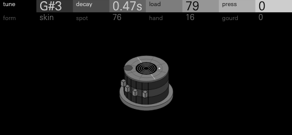

# Syahi



One struck head, loaded and shaped into any drum. Syahi is a synthesis drum
kit for the OP-XY: each of its 24 keys holds one of eight models (BOOM,
SNARE, TOM, TABLA, BAR, METAL, BOUNCE and WIRE) and eight controls of its own.
Every model plays the same object, a head of eight modes, so TUNE, DECAY,
FORM and SPOT sit in the same places on every key, and FORM turns any key
through bare skin, a loaded head, a slab of wood, a tuned bar, a thin plate
and a bell. A kick can become a slit drum, a bar or a gong on one knob, and
every setting in between is an object you could build.

## Origin

In 1920 C. V. Raman and Sivakali Kumar wrote to *Nature* about a puzzle
("Musical drums with harmonic overtones"). A stretched circular head rings
at about 1, 1.59, 2.14 and 2.30 times its lowest note, which is why most
drums thud or clang rather than sing. The tabla and the mridangam sing all
the same. Raman showed why, and returned to it at length in 1934 ("The
Indian musical drums", Proceedings of the Indian Academy of Sciences): their
heads are loaded. On the tabla the load is the *syahi* (Hindi and Urdu for
"ink"), the black circle on the head. Tabla makers in North India build it
up from a paste of flour and iron filings or iron oxide, in many thin layers,
each rubbed down with a stone before the next. Its weight pulls the head's
lowest nine modes into a near-harmonic series of five tones, so the drum
plays a note. The syahi is part of the craft of those makers and of the
players of the Hindustani tradition who shaped the instrument; this machine
borrows the name to honour their idea, not to copy the tabla.

Syahi takes the idea seriously. LOAD pulls whatever the head is toward
harmony, as Raman's paste does, and the rest of the models load, thin,
thicken or dome the same head. WIRE starts from another struck object: Ben
Burtt's blaster for *Star Wars* (1977), a hammer on the guy wire of a radio
tower, where the wire's dispersion makes the highs arrive first.

## Playing it

Choose Syahi on a drum track. The default kit has a kick, an 808 kick, a
snare and a brush, a clap and a flam, closed, pedal and open hats, three
toms, ride, crash, a tabla's "na" and "ge", a djembe slap, a cowbell, a
marimba, a gamelan key, a zap, a sub drop, a talking drum and a gong.

Press any encoder to switch rows. Both rows show at once, the one the
encoders edit brighter.

Hold Shift for each key's mixer channel. On the first row, MACHINE chooses
the key's model, CHOKE its choke group (none, 1, 2, 3), PAN and LEVEL its
pan and level. On the second, HUMAN and GRIT are the key's own pad
controls, and FX I and FX II its own sends (TRK follows the track's). Press
an encoder with Shift held to reach the second row.

A key played again cuts its last note (as a Machinedrum track does), so a
roll on one key stays one voice.

### Shift rows

| Row | Encoder | Range | What it does |
| --- | --- | --- | --- |
| 1 | MACHINE | boom … wire | The key's model (BOUNCE shows as "bnce", to fit its column). Its eight controls keep their values |
| 1 | CHOKE | none, 1, 2, 3 | Keys in one group cut each other (closed and open hats) |
| 1 | PAN | -100 … 100 | The key's pan |
| 1 | LEVEL | -30dB … 0dB | The key's level |
| 2 | HUMAN | off, 1 … 15 | Each hit lands a little off its SPOT, a little softer and a little off pitch (at 15: SPOT spread by about 14 steps, up to 30% softer, about 14 cents), drawn from the key's own note count. On screen the strike mark wanders with it |
| 2 | GRIT | -16 … +15 | Below 0 a tape-rounded hit (a low-pass from 16 kHz down to 1.2 kHz); above 0 a tanh drive; above +9 the rate and bits drop too (each sample held 3 to 13 times, 13 down to 6 bits under the hit's peak) |
| 2 | FX I, FX II | TRK, 0 … 100 | The key's own send to each effect |

## The models

Every model's first row is TUNE, DECAY and two of its own; its second row is
FORM, SPOT and two more. Ranges are at 0 and 100. TUNE shows the note,
DECAY the time to fall 60 dB, FORM the nearest material; COUNT, GAP, RATE,
BEAT and SQUEEZE show their units, the rest 0 to 100.

**FORM** (every model): sine, load, skin, wood, bar, plate, bell. The head's
eight mode ratios move between seven anchors in log space: one sine (an
808), Raman's loaded head (1, 2, 3, 4, 5 …), the ideal membrane's Bessel
ratios (1, 1.59, 2.14, 2.30 …), a thick slab, a free bar with its undercut
partial tuned (1, 2.76, 3.98 …), a thin plate, and a bell's hum, prime,
tierce, quint and nominal. Each anchor also sets how a strike weighs the
modes and how fast the upper ones die. The strike's energy stays the same
across FORM, so it changes the tone and not the level. From the bar on, the
upper modes die sooner between two anchors, and a mode that would slide more
than two octaves fades out and back in, so the settings between bar, plate
and bell ring as inharmonic metal rather than a clang; the bell keeps its
prime on the note. A drum (not METAL or BAR) turned to plate or bell strikes
softly any mode that lies within 50 Hz of a stronger one, where the beat
falls in the ear's roughest band, so a low tom made of bronze rings its note
instead of clanging (at FORM 127 a low tom's tierce sits 14 dB lower).

**SPOT** (every model): centre to rim. A centre strike rings the round
modes, an edge strike the modes with nodal diameters.

| Model | TUNE | DECAY | Row 1, A | Row 1, B | Row 2, C | Row 2, D |
| --- | --- | --- | --- | --- | --- | --- |
| **BOOM** (kicks) | 30–110 Hz | 0.12–2.6 s | **BEND**: the struck head's pitch lift, 0 to 2.6 octaves falling over 18–48 ms (an 808's sweep) | **BEATER**: felt to wood to plastic (a 5.5 ms to 0.07 ms contact), with its thump, knock or click | **SHELL**: the shell's boom under the head, louder, longer (0.08–0.78 s) and lower (0.86 to 0.66 of the note) | **AIR**: the head's push on the room, a 48 Hz breath of 1.5 to 4 cycles |
| **SNARE** | 120–340 Hz | 0.07–0.8 s | **WIRES**: none to a loose buzz | **STICK**: a brush (the first third), then a stick whose crack grows, then a rimshot (the last fifth); the wires slap with it within 1 ms | **SNAP**: the wires' tone (1.5–5.2 kHz) and tightness (their buzz 0.32 to 0.05 s) | **HEAD**: the head's level against the wires, from wires alone (a 909) to a ringing head |
| **TOM** | 55–330 Hz | 0.15–2.6 s | **BEND**: the strike's drop, 0 to 1.6 octaves | **SQUEEZE**: the talking drum's armpit: the pitch falls (-100) or rises (+100) an octave after the strike | **MALLET**: felt to stick, with a stick's tick past a third | **HEADS**: a second head detuned 0–7 Hz, from still to a beating swell |
| **TABLA** | 90–560 Hz | 0.1–2.2 s | **LOAD**: a bare head's thud to Raman's singing syahi (it pulls the modes harmonic and lowers the note up to 18%) | **PRESS**: the palm's heel pressing, the pitch gliding up to an octave (the bayan's "ge") | **HAND**: a fingertip to an open slap | **GOURD**: a cylinder to a round-bellied pot, its Helmholtz bass louder and lower |
| **BAR** | 160–1700 Hz | 0.1–3.2 s | **BEAT**: a twin key's beat, 0 to 8 Hz (the gamelan's ombak) | **MALLET**: yarn to rubber to brass, with a hard mallet's tick | **TUBE**: a resonator under the bar: the fundamental up to 3.5 times longer and 2.5 times stronger | **ALLOY**: rosewood (the overtones die) to bronze (they ring, and strike brighter) |
| **METAL** | 160–2600 Hz | 35 ms–4.5 s | **WASH**: a clean bell to a dense cymbal spray (the modes' coupling), at one level | **STICK**: a soft beater to a brass tip, with a tick at the top | **SWELL**: energy climbing into the upper modes after the strike (a gong's bloom) | **SIZZLE**: rivets and a chain rattling |
| **BOUNCE** (claps, flams, rolls) | 90–1400 Hz | 30 ms–1.0 s | **COUNT**: 1 to 24 strikes, sharing one strike's energy | **GAP**: 4 to 140 ms between the first two | **HANDS**: a stick to flat palms: each hand a 4.5 to 2.8 ms burst of noise in a band from 1 to 6 kHz (it follows TUNE) with air above it, the last clap the loudest, ringing on | **SHRINK**: each gap 0.57 to 1.27 times the last: a dropped stick speeding up, an even roll, slowing |
| **WIRE** (zaps, drops, blips) | 30–1600 Hz | 50 ms–3.2 s | **SWEEP**: a 0 to 5 octave drop | **RATE**: how fast it drops, 4 to 500 ms | **SPRING**: dispersion, evenly from none to 0.9: the highs sweep further, a smeared "pew" | **HAMMER**: soft to hard: brighter, up to 40% more drop, and the clamp's click |

Every control changes the sound across its whole travel: `tests/sound.cpp`
renders each model with each control at 0, 32, 64, 96 and 127 and fails any
quarter that moves no audible band by 0.75 dB; `tools/sweep.py` looks in
eighths. BAR's SPOT and WIRE's SPRING change the sound right to the top of
their travel (on BAR the last two fifths of SPOT near the fundamental's node
and take up to 0.8 of it away); the gentlest steps left are BOOM's AIR from
64 to 80 and METAL's SPOT from 112 to 127, about 1.1 dB.

## Kits

Syahi ships nine presets, each a whole kit: `default` and eight styles.

| Kit | Style | On the keys |
| --- | --- | --- |
| **VOLT** | 808 and 909 | A sine kick with a long bend, a 909 kick, a 909 snare (wires high, head low), clap, ring-washed hats, WIRE toms and blips, a wooden rim, cowbell, conga and clave |
| **STUDIO** | Acoustic rock and funk | Kicks with shell and air, a snare and a rimshot, flams and buzz rolls, hats, double-headed toms, ride, crash, ride bell, china, tambourine, sidestick, brush |
| **RAMAN** | Tabla, djembe and gamelan | The dayan's na, tin, te and tun with a heavy load, the bayan's ge (pressed and open) and ke, djembe bass, tone and slap, shaker, kanjira, ghatam, five bronze keys with a 3 Hz beat, bell, manjira, talking drum, udu, gong |
| **KEBYAR** | Balinese gamelan | Paired keys (BEAT 5–7 Hz) in a pelog-like tuning across eight keys, reyong, kempli, kajar, ceng-ceng, kempur, gong ageng and kendang |
| **DJELI** | West African | Dundun, sangban and kenkeni, djembe bass, tone and slap, shekere, bells, talking drums, a five-key balafon, kesing-kesing, udu, calabash |
| **FOUNDRY** | Industrial | A driven kick, rimshot and metal snares, a ratchet, a chain, plates and sheets, pipes, an anvil, beating toms, a hammer, a spring, a zap, a sub drop, a boiler and a gong |
| **SHARD** | Glitch | Sine and click kicks, snaps and noise, ratchets 4 and 8 ms apart (they turn pitched), ticks, blips, chirps, fast and slow rolls, a dropped stick, glass, a zip, a bubble |
| **TRAILER** | Cinematic | Taiko and odaiko, a war snare, brush rolls, hits and stomps, an anvil, a chain, a sizzle, deep toms, a tam-tam, a braam and a sub drop, bells, a bowl, a frame drum, thunder |

A preset holds each key's model, eight controls and choke group, and its
mixer channel: pan, level, FX I and FX II sends, HUMAN and GRIT (FOUNDRY's
kick is driven at GRIT +9, RAMAN's bols vary with HUMAN, TRAILER's taiko is
rounded at GRIT -6). Stock's preset writer keeps a pad word's top 16 bits as
`random`, which holds HUMAN, GRIT and the sends, and `pan` and `gain` beside
it; `tools/presets.py` writes them and decodes every preset back to check. Every hit is set to a
loudness, not a peak (`tools/calibrate.py` writes `levels.h`), measured as
BS.1770's K-weighting over a hit's loudest 400 ms, in dB under the SDK's
half-scale ceiling: kicks and toms at -16.5, everything else at -19, each
model's default hit with its true peak at -1 dB. Where a peak would stop a
hit short, the model's soft knee starts lower and rounds its first sharp
moments under the ceiling, taking at most 1.8 dB off the peak (BOOM, TABLA,
METAL and WIRE; 0.3 to 0.6 dB on SNARE, TOM and BOUNCE). So the defaults sit
at -17.8 (BOOM), -17.6 (TOM), -19.9 (SNARE), -18.9 (BAR), -20.0 (METAL) and
-19.3 (BOUNCE); TABLA's short stroke at -22.3 and WIRE's zap at -23.4 reach
their peak first (in their first 100 ms they are as loud as the snare). Each
control's travel is trimmed to hold that loudness: a lift never past the
-1 dB peak (lifts don't add up: only a hit's largest applies), a cut taking
back three quarters of what the control adds (half of DECAY's, so a long ring
still sounds longer and louder). Each preset key's LEVEL takes off the rest:
156 of the presets' 216 keys sit within 1.5 dB of their role's loudness and
none more than 1.5 dB over it; the rest are mostly short hits held by their
peaks. Closed hats sit at DECAY 30 to 32, pedal hats 42 to 44, open hats 80 to 84, rides 104 to 108 and crashes 120 to 122
(a crash falls 40 dB in 2.1 to 2.2 s).

## Demos

Rendered from the real engine on a computer (`tools/demos.py`), in stereo
from each key's own pan and level:

- [demo-hits.mp3](docs/demo-hits.mp3): each model's default hit, then the default kit's 24 keys.
- [demo-form.mp3](docs/demo-form.mp3): a mid tom struck with a stick, swept through FORM from sine to bell, then a tabla through LOAD, bare to loaded.
- [demo-volt.mp3](docs/demo-volt.mp3), [demo-raman.mp3](docs/demo-raman.mp3), [demo-foundry.mp3](docs/demo-foundry.mp3): grooves on three kits.

Each file is 44.1 kHz stereo, scaled by one gain to -16 LUFS integrated (ITU-R BS.1770) or lower where its peak would pass -1 dBFS, with no other processing.

## How it works

```
strike(s) -> eight modes (FORM, LOAD, SPOT; pitch lifted by the struck energy)
          -> + wash (a metal's mode coupling) + noise (brush, palm, clap, a stick's tick)
          -> METAL's tilt -> + rattle (wires that buzz only while the head swings past them)
          -> + body (one resonance below the head) + air -> GRIT -> out
```

**Modes.** Each mode is a sine read from a 16,384-step table. Its phase
increment and amplitude are planned once a block and stepped linearly
through it, so a pitch that falls fast (a 4 ms zap) glides sample by sample
instead of stepping, and a mode decays exactly as its time says. A mode's
ring time is DECAY times its ratio to the lowest to the power of the
material's tilt. A strike lands on its own sample and ramps in over the
contact time as a raised cosine, so felt is soft and brass clicks; up to 24
strikes (BOUNCE) each land where they fall. A soft contact rolls off the
modes above 1 / (2 × contact), and the strike's energy is then restored, so
the striker changes the tone and not the level.

**Tension.** The struck energy lifts the pitch and lets it sag back, a
kick's or a tom's drop, an 808's sweep, a laser's zap. On WIRE the lift
grows with each mode's ratio (dispersion), so the highs sweep further.

**Wash.** METAL multiplies pairs of modes, as a cymbal's modes couple:
four products, two square-wave products whose odd harmonics fill the top
octaves, and noise as loud as the modes it rides on, through a band that
follows the note (a high-pass at twice it, 0.9 to 3 kHz, and a low-pass at
ten times, 5 to 12 kHz). Each pair rings as long as its two modes together,
and a metal's upper modes ring nearly as long as its lowest, so the spray
shimmers for as long as the cymbal sounds. A strike passes into the pairs
over a third of the ring (40 to 150 ms to -60 dB, given back in level), so
the spray swells in under the stick's click rather than spiking with it. As
WASH rises the wash takes the modes' energy and the two keep one level.

**Tilt.** METAL's whole sound, before its rattle, is averaged with the
sample before it: a zero at Nyquist and no filter pole, which takes the
square-wave products' fizz out of the top octave. A hat's spectral centroid
sits at 8.1 to 8.9 kHz (MD KIT's hats 8.6 to 8.9) and its crest at 15 to 17
dB, 18 with a pedal hat's sizzle (MD KIT's 13 to 15).

**Rattle.** A follower on the head's swing; past a gap (a share of its peak)
the wires buzz, answering at once and settling over SNAP's time: noise
through a band-pass at the wires' tone, a 900 Hz high-pass and two
one-poles for a low-pass with no notch at Nyquist.

**Fixed point.** Everything is integer: Q31 signals, pitches and times as
log2 values with table exp2 and log2, no division in any per-sample path
(per-note and per-setting work divides a few times). A voice frees itself
(`finished`) once it has stayed under -96 dB for 90 ms with no strike to
come.

## The screen

An engraved plate, after the way old instrument catalogues drew an
instrument twice: the selected key's object in section on the left, standing
on the floor and filling the plate from the header down, and from above on
the right. The
section is cut open: the shell's walls, its dark inside with the far wall's
lug bolts, the hoops, lugs and tension rods, and what it stands on: a
kick's spurs, a snare stand's basket and tripod, a floor tom's legs, the
thunder drum's frame, a tabla's cushion, a practice pad's stand. The bar is a marimba key with
thick ends and an arched undercut, a cord through the hole at each node, on
rails and posts over a trestle, its resonator hanging below with a flared
mouth and a stopper. The cymbal shows its bell, bow and thinning edge
between felts on a sleeve under a wing nut, on a stand with a tilter, a
height clamp and a braced tripod. The plan is the head itself: a drum's
hoop and lugs, the tabla's braid, straps and layered syahi, the cymbal's
lathe lines, edge and bell, and four keys of a marimba on its frame: the
bar, its twin and the keys either side, a shorter and a longer, each with its
grain and the holes the cords run through, over the rails and the posts
between the keys. The tabla and the bounce are played by hand: Max's drawing of a pointing
hand, traced line for line, the forearm in from the upper left, the index
finger out and pointing down onto the head, the thumb lying over the fist and
three curled fingers stacked under it, with the crease where the wrist meets
the palm. It is drawn whole and never reshaped: a hit swings it down about
the wrist until the index's tip touches the head. BOUNCE's hand holds a
drumstick under the index, in a pointer grip. The striker comes from the left; where it can't reach the
strike point from there without swinging down beside the head (a stroke out
at the rim, a rimshot, a big low drum), it comes from the right, over the head.

Every control moves a part:

| Control | What moves |
| --- | --- |
| TUNE | The whole object's size, to 0.8 in section (still standing on the floor) and 0.86 from above (a smaller drum is a higher note); on TABLA the gatte hammered down the straps |
| DECAY | A folded cloth on the head: over half of it for the shortest ring, smaller as the ring lengthens, sliding off the rim for the longest |
| FORM | The head's section: thin skin, a syahi lens, a slab, an undercut bar, a cymbal's bell and bow, a bell. A head domed high draws the section a little smaller so it stays under the header |
| SPOT | The striker and the strike mark move out from the centre; the nodal circles give way to diameters |
| BEND, SQUEEZE | Tension rods backed out and a slack, sagging head; the lacing's waist pinched in or bowed out (a talking drum) |
| BEATER, STICK, MALLET, HAND, HANDS, HAMMER | The striker itself: a felt, wooden or plastic beater; a brush, a stick, a rimshot; a yarn-wound ball shrinking as it hardens; the hand's swing: HAND cocks the wrist further back at rest, from a fingertip's small flick to a slap's full swing; HANDS slides BOUNCE's stick back through the fist over its first 60% (the fingertip then strikes) and widens the swing; a soft or steel hammer |
| LOAD, PRESS, GOURD | The syahi's lens and the plan's layered disc grow; the palm's heel goes down and dents the head; the shell bellies into a pot, its straps lying on the belly |
| SHELL, AIR, HEADS | The kick's shell deepens, its port going down with it and its spurs shortening to the floor; rings of air out of the port; the second head, detuned, seen through the first |
| WIRES, SNAP, HEAD | The snare wires under the bottom head: at none they hang clear of it, and as WIRES rises they press to it and swing wider; the strainer's lever, hanging out from the shell for loose wires and thrown up against it as they draw tight (and the wires finer and flatter); the muffling ring, a wide band across the head from above for a dead head, a narrow one at the rim for a ringing one |
| BEAT, TUBE, ALLOY | The twin key beside the bar, shorter and turned; the resonator lengthens toward the floor, its stopper with it; the wood's grain fades and the bar thins as it turns to bronze |
| WASH, SWELL, SIZZLE | The lathe's grooves, cut one by one between its lines and brighter as they deepen; a gong's turned-down rim; rivets round the edge and a chain hanging over it |
| COUNT, GAP, SHRINK | The stick's bouncing path over the head and its marks from above |
| SWEEP, RATE, SPRING | The spring under the thunder drum: its width, its stretch, its coils |
| HUMAN | The strike mark wanders, hit to hit, as the sound does |

A hit flexes the head (up to 8 px) in the stroke's mode, sends two rings
out from the strike mark and draws the nodal lines of the mode it excites
on the head from above, bright and fading as it rings down: circles for a
centre strike, diameters toward the rim, and across a bar its first mode's
two nodes or its second mode's three (the bar flexes as a free bar does,
still at the cords). The motion lasts as long as the
sound: it follows DECAY. A kit's voice plays until its own sound ends (the
OP-XY applies no amp envelope to a drum kit's voices, and letting a key go
changes nothing), so the screen ignores the envelope page too.

The screen is 267 nodes of 512 and four reshaping outlines of 64 points (the
head, the shell, the part that couples to it, the striker; the hand is static). The section is
drawn at 1.25 times its artwork, the plan at 1.06. Every line draws about
1 px wide, as stock Drumline's do (the four outlines have palette entries of
their own, since their scale of 1.25 widens a stroke), and ribbons about 1.4
px across; greys step from near white for the subject (head and striker)
through structure and detail to engraving. The dark bodies (the shells' insides, the heads, the cymbal and the
bars from above, the stands) are fixed fills drawn under the outlines;
nothing that moves is filled. Every outline is a closed ribbon checked
against the OP-XY's drawing rules over every value of every control
(`tests/screen.cpp`) and by a screen checker over 9.8 million frames (no
faults, nothing over the header). Nothing changes at rest; while hits
sound 3.2 to 10.6 nodes change a frame on average (peak 17). A turned control
that moves many parts at once (TUNE scales the whole object) moves them
over a few frames, never more than 26 nodes in one; only a model switch
redraws everything at once.

Contact sheets at the screen's own size, each model with every control at
0, 50 and 100, both Shift rows and a hit: [boom](docs/sheets/boom.png),
[snare](docs/sheets/snare.png), [tom](docs/sheets/tom.png),
[tabla](docs/sheets/tabla.png), [bar](docs/sheets/bar.png),
[metal](docs/sheets/metal.png), [bounce](docs/sheets/bounce.png),
[wire](docs/sheets/wire.png), and [all eight](docs/sheets/overview.png).

## CPU

Two estimates, both per voice per 64-sample
block, against the OP-XY's 580,352-cycle block:

| Model | Static count, a strike's block | Ringing | Host-timed, heaviest setting |
| --- | ---: | ---: | ---: |
| BOOM | 13,800 (2.4%) | 10,900 (1.9%) | 3.7% |
| SNARE | 13,600 (2.3%) | 10,800 (1.9%) | 5.2% |
| TOM | 10,200 (1.8%) | 10,200 (1.8%) | 3.5% |
| TABLA | 13,000 (2.2%) | 10,200 (1.8%) | 3.8% |
| BAR | 9,400 (1.6%) | 9,400 (1.6%) | 3.5% |
| METAL | 17,300 (3.0%) | 14,500 (2.5%) | 7.0% |
| BOUNCE | 12,200 (2.1%) | 9,400 (1.6%) | 5.2% |
| WIRE | 12,200 (2.1%) | 9,400 (1.6%) | 3.6% |

The static count (`tools/static_cpu.py`) compiles each per-sample loop with
the SDK's pinned Blackfin compiler, counts its instructions and adds up a
block: a floor, since stalls add cycles, and GRIT's drive adds about 1,000.
The host figure (`tools/cpu.py`) times the render against the SDK's
reference loop, as `sdk.py test` does for synths, at the slowest of every
control's nine positions with GRIT on and off; it overstates the Blackfin,
where a Q31 multiply is one instruction, and varies by a fifth between runs.
METAL with its wash, wires, tilt and stick noise is the heaviest; it runs
the wires' pass always, since its tilt rides in it. Silent voices free themselves, and a key cuts its own last note, so a kit holds at most 16
voices and usually far fewer.

## Memory

178 KiB of the 2,032 KiB module region in a firmware of its own (`sdk.py
compile`): a 32 KiB sine table, the filter, log and exp tables, 16 voices of
1,304 bytes, 2.3 KiB shared and the screen's artwork.

## Building

Syahi needs SDK 1.10, with per-key mixer channels (`padMix`, `padControls`,
`padSend`).

```sh
python <sdk>/sdk.py test --machine syahi
python <sdk>/sdk.py test --machine syahi --firmware
python3 syahi/tools/compilers.py --sdk <sdk>   # tests under clang, g++ and sanitizers; renders bit for bit alike
python <sdk>/sdk.py build --machine syahi --stock-os <your stock-1.2.1>/os.ldr --layout <your device's layout.json> --out <a folder outside this checkout>
python syahi/tools/presets.py <that folder>          # the kits, into candidate/content/presets/syahi/
```

Install the build's `candidate/` files as the SDK's build guide describes.

## Develop

`engine.cpp` and its headers (`voice.hpp` the core, `models.hpp` the eight
models, `form.hpp` FORM's anchors, `dsp.hpp` the fixed-point helpers) are the
sound; `display.cpp` and `art.h` the screen, with its artwork generated by
`tools/make_panel.py`. `tools/kits.py` holds the default kit and the eight
presets (`tools/make_kit.py` writes `kit.h`). `tools/render.cpp` plays the
engine on a computer; `tools/compare.py`, `tools/sweep.py` and
`tools/calibrate.py` (with `tools/levels.cpp`) measure it, the last writing `levels.h`; `tools/sheet.py` draws the screen from the
real display code in the OP-XY's font.

## Licence

MIT ([LICENSE](../LICENSE)).
