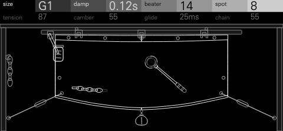
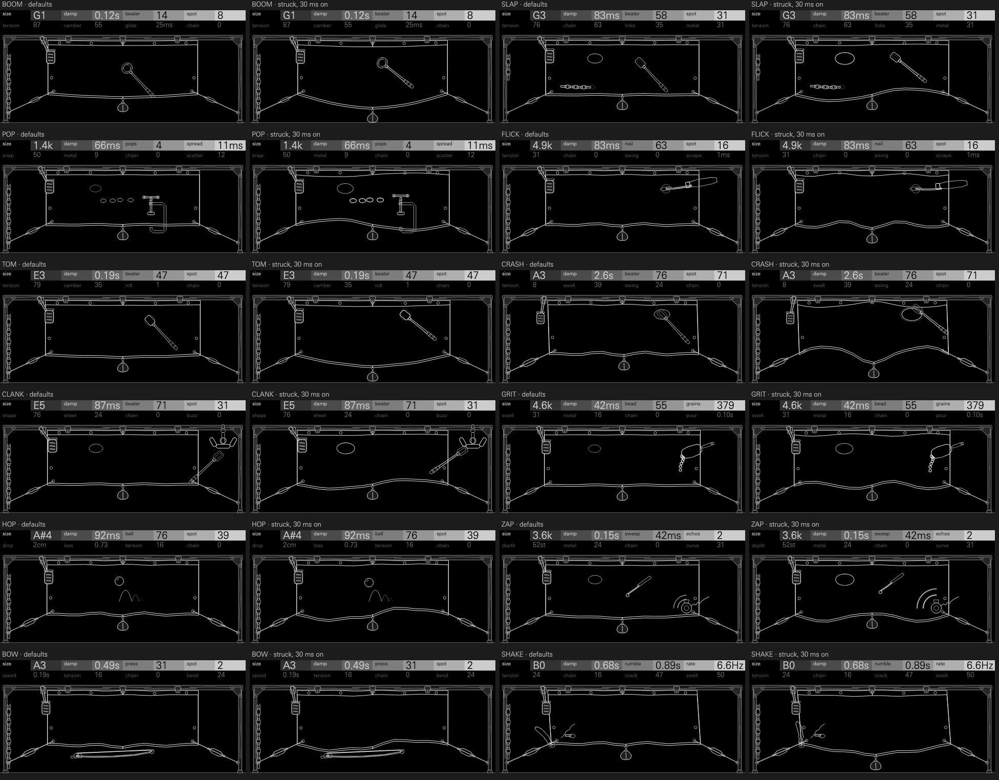

# THUNDER



One theatre thunder sheet, played every way a stagehand would, as a drum kit.
Each of the 24 keys holds one of twelve ways of playing the sheet: struck
with a mallet, flicked at a corner, snapped through a dent, poured on,
dropped on, bowed, shaken by its handle, or heard from a pickup at its far
corner. Struck hard on a tight sheet it is a kick or a tom; slack, it is a
crash; flicked, a hat; with a chain lying across it, a snare. The same
physical controls (the sheet's size, the felt damper, the beater, where it is
struck) sit on every key, so a kit is quick to learn and step locks move
between sounds sensibly.

**Origin:** the thunder sheet. From the 18th century, stagehands made storms
with a tall sheet of iron hung in the wings. Shaken by its handle it rolls
like distant thunder; struck with a mallet it booms; flicked at a corner it
hisses. Foley artists still use one, and they bow it, scrape it, drop things
on it and strew it with chain.

One thin sheet behaves like two instruments. Pulled tight in its frame,
tension rules: its low modes crowd together like a drumhead's. Hanging slack,
bending stiffness rules (f² = T k² + D k⁴): its modes spread apart and, above
a few kHz, become a dense, even forest, the sizzle of a cymbal. Struck hard,
the sheet stiffens, so a big hit starts sharp and sags in pitch as it rings.
Bending waves are dispersive, so a tap heard at the far corner arrives as a
falling chirp. A dent pressed in snaps through with a crackle. And a chain
lying on the sheet lifts and slaps down wherever the sheet moves harder than
the links weigh: a snare's wires, on any sound.

## Playing it

Load THUNDER on a drum track. The 24 keys start as a kit laid out as stock's
drum kits are: kick, snare, three toms, clap, rim, cowbell, closed and open
hats, ride, crash, then a shaker, a bouncing bearing, the laser, a
thunderclap, and eight more.

- **Eight controls a key.** The four encoders hold the key's first four
  controls; press any encoder to switch them to the second four, and again
  to come back. Both rows are drawn in the header, the one the encoders turn
  bright.
- **Choose a key's model:** select the key, hold **Shift** and turn
  **encoder 1** (MACHINE). Any key can hold any of the twelve.
- **Its mixer channel, on Shift's first row:** **encoder 2** puts the key in
  choke group 1, 2 or 3, or none (CHOKE: keys in a group cut each other off;
  the hats start in group 1); **encoder 3** pans it (PAN, -100 to 100);
  **encoder 4** sets its level (LEVEL, 0 dB down to -30 dB).
- **Its pad controls and sends, on Shift's second row** (hold Shift and press
  any encoder): **encoder 1** is TUNE, -16 to +15 semitones, which tunes a key
  without touching its SIZE; **encoder 2** is DRIVE, the contact pickup
  overloaded, OFF then 1 to 15; **encoders 3 and 4** (FX I and FX II) set the
  key's own sends: TRK follows the track's send, then 0 to 100 whatever the
  track's send is.
- **One voice a key.** A new hit on a key cuts its last one, as a sheet
  struck again stops ringing where it was.
- **Saving:** each key's model, controls, choke group, pan, level, TUNE,
  DRIVE and sends go in projects and presets (a preset carries the pad
  controls as stock does, in the key's `random` field).

The OP-XY gives synthesis drum kits no velocity of their own, so a hit's
strength is its controls. Nor does it apply the track's amp envelope (M2) to a
kit: a hit plays to its own end, so its length is DAMP and the model's own
controls, and letting go of the key changes nothing.

## The models

The first row is the same on every model: **SIZE**, the sheet's size (shown
as a note, or as the band it rings in), and **DAMP**, the felt damper
pressed on it (shown as its ring time). The third and fourth controls are
the beater and where it strikes, or that model's own gesture. Figures are a
hit with the other controls at their defaults (tools/sweep.py): spectral
centroid and the time to fall 40 dB.

| Model | Role | Row 1 | Row 2 |
| --- | --- | --- | --- |
| BOOM | kick | SIZE DAMP BEATER SPOT | TENSION CAMBER GLIDE CHAIN |
| SLAP | snare | SIZE DAMP BEATER SPOT | TENSION CHAIN LINKS METAL |
| POP | clap, snap | SIZE DAMP POPS SPREAD | SNAP METAL CHAIN SCATTER |
| FLICK | hats | SIZE DAMP NAIL SPOT | TENSION CHAIN SWING SCRAPE |
| TOM | toms | SIZE DAMP BEATER SPOT | TENSION CAMBER ROLL CHAIN |
| CRASH | crash, ride, china | SIZE DAMP BEATER SPOT | TENSION SWELL SWING CHAIN |
| CLANK | cowbell, rim | SIZE DAMP BEATER SPOT | SHAPE SHEET CHAIN BUZZ |
| GRIT | shaker | SIZE DAMP BEAD GRAINS | SWELL METAL CHAIN POUR |
| HOP | a dropped bearing, for fills | SIZE DAMP BALL SPOT | DROP LOSS TENSION CHAIN |
| ZAP | laser, dispersion | SIZE DAMP SWEEP ECHOS | DEPTH METAL CHAIN CURVE |
| BOW | the singing sheet | SIZE DAMP PRESS SPOT | SPEED TENSION CHAIN BEND |
| SHAKE | thunder, risers | SIZE DAMP RUMBLE RATE | TENSION CHAIN CRACK SWELL |

### The controls

| Control | Models | Caption at 0 / 50 / 100 | What it does |
| --- | --- | --- | --- |
| SIZE | all | BOOM `B0` `A1` `G#2`; TOM `A1` `D#3` `G#4`; FLICK `2.6k` `4.9k` `9.0k` | The sheet's size as its pitch, about two octaves on the drums (BOOM 30 to 105 Hz, TOM 55 to 420 Hz), or the band a flick, a snap, a pour or a chirp rings in. On screen the sheet grows, from 264 to 336 px wide. |
| DAMP | all | BOOM `1.3s` `0.18s` `25ms`; CRASH `3.2s` `1.3s` `0.55s` | The felt pad pressed on the sheet: how long it rings, from over a second to a dead thud. BOOM falls 40 dB in 5.8 s, 0.80 s and 0.11 s; at its default it rings 0.55 s, a deep kick whose body holds for a third of a second. On screen the felt pad swings in on its lever from beside the sheet until it presses the iron, and squashes. |
| BEATER | BOOM SLAP TOM CRASH CLANK | `0` `50` `100` | Felt, then wood, then a steel rod: how long the mallet stays on the sheet (6 ms to 0.08 ms, and a felt never longer than one cycle of the note), so how many of its modes it reaches, and its knock on the head, from a felt thud (on BOOM and TOM, 300 to 700 Hz) to a ringing click. The drum keeps its weight across the travel, within half a LU at the defaults: a felt thud is as loud as a steel strike. A tom's centroid moves 223, 373, 406 Hz. On screen the head turns from a wrapped felt ball to a wooden barrel to a bare steel rod. |
| SPOT | BOOM SLAP TOM CRASH CLANK FLICK HOP BOW | `0` `50` `100` (BOW: the mode, `1` to `5`) | Where it is struck, from dead centre (odd modes only, a round thump) to near a corner (every mode, clangorous). On BOW, which of the sheet's modes sings. On screen the mallet, flicker, ball or bow moves. |
| TENSION | BOOM SLAP FLICK TOM CRASH HOP BOW SHAKE | `0` `50` `100` | Plate to membrane: a slack sheet's modes spread into metal, a taut one's crowd into a drum. On CRASH it brings the drum-like body up under the wash (centroid 7.8, 7.6, 7.3 kHz); on SLAP it tightens the head, half an octave up, with less sag. On FLICK it moves the sizzle's six modes. On screen the turnbuckles screw in and the sheet's buckled edges flatten. |
| CAMBER | BOOM TOM | `0` `50` `100` | How far a hit's pitch sags as the sheet relaxes, up to 3.5 times on BOOM: a kick's drop, from physics, not an envelope. On screen the sheet curves under its straight batten. |
| GLIDE | BOOM | `6ms` `29ms` `0.14s` | How long the sag takes. On screen the rigging sandbag grows. |
| CHAIN | all | `0` `50` `100` | Links lying on the sheet, from none to full snare wires on anything: they slap when the sheet lifts them, more of them, longer. The links ring a band topped at 6 to 7 kHz: a rattle, not a fizz. A kick with CHAIN 50 has its centroid move from 78 Hz to 5.4 kHz; on SLAP more wires buzz louder and longer. On screen links leave the cleat on the left post and lie across the sheet's face. |
| LINKS | SLAP | `0` `50` `100` | The wires from tight and bright (a short, high buzz) to long and loose (lower, and rattling on). On screen the links grow. |
| METAL, SHEET | SLAP POP GRIT ZAP; CLANK | `0` `50` `100` | The sheet's own ring under the sound, from dry to a long metallic tail. On screen rings spread over the sheet's face, none when it is dry, one, then three, wider and brighter, and a hit swells them. |
| POPS | POP | `1` `4` `7` | How many snaps: one for a finger snap, seven for a crowd. On screen, as many dents. |
| SPREAD | POP | `4ms` `11ms` `32ms` | Time between snaps, from one fat clap to a flam. On screen the dents spread apart. |
| SNAP | POP | `0` `50` `100` | A soft pap (a 9 ms burst) to a hard click (0.6 ms), and higher. On screen the clamp's screw is driven in. |
| SCATTER | POP | `0` `50` `100` | Timing, level and crackle of the snaps, from machine-tight (every clap the same, its peak within about 1 dB) to ragged. On screen the dents scatter. |
| NAIL | FLICK | `0` `50` `100` | A fingertip to a coin's edge: the tick of the flick, how bright the ring is and how much noisy sizzle runs among its clangs. On screen the tip turns from a pad to a coin. |
| SWING | FLICK CRASH | `0` `50` `100` | The sheet swaying on its chains: a slow swish through the ring, and the sheet turning away (up to 9 dB quieter at the far end of its swing), for open hats and washes. On screen the sheet leans and sways. |
| SCRAPE | FLICK | `2ms` `9ms` `60ms` | A tick to a dragged brush stroke (the flick lasts this long). On screen a brush's scuff draws across the sheet. |
| ROLL | TOM | `1` `5` `8` | Strikes in one hit, from one to a flam, a ruff and a roll, each softer and quicker. On screen the strikes are marked round the spot. |
| SWELL | CRASH | `0` `50` `100` | A gong-like bloom: energy cascading into the high modes, peaking 30 ms to 450 ms after the hit (CRASH falls 40 dB in 1.3, 2.1, 3.5 s). On screen the bloom spreads from the strike. |
| SHAPE | CLANK | `0` `50` `100` | The frame's shackle bent from a straight bar (free-bar partials 1 : 2.76 : 5.40) into a stirrup (1 : 1.47 : 2.09), a two-tone cowbell. On screen its arms bend up. |
| BUZZ | CLANK | `0` `5` `10` | The shackle loose on its pin, chattering: up to ten re-strikes, closer as it rises. On screen its nut backs off the pin. |
| BEAD | GRIT | `0` `50` `100` | Soft grains to hard shot: higher, shorter ticks (centroid 4.0, 5.7, 7.0 kHz). On screen the beads grow. |
| GRAINS | GRIT | `40` `222` `1200` | Grains a second at the pour's height. On screen, more beads in the stream. |
| SWELL | GRIT | `0` `50` `100` | A pour that starts hard ("chk") or swells ("shhk"). On screen the beads bunch at the lip or spread down the stream. |
| POUR | GRIT | `50ms` `0.16s` `0.50s` | How long the pour runs. On screen the scoop tips further. |
| BALL | HOP | `0` `50` `100` | A rubber ball to a steel bearing: how hard each bounce strikes. On screen the ball shrinks and shines. |
| DROP | HOP | `0cm` `3cm` `18cm` | How high it falls from: the first bounce's length (60 to 380 ms), so how long it bounces (0.37, 0.75, 1.6 s). On screen the ball waits higher and its arcs grow. |
| LOSS | HOP | `0.88` `0.69` `0.52` | Restitution: how much height each bounce keeps (1.15, 0.56, 0.44 s of bouncing). On screen each arc is smaller. |
| SWEEP | ZAP | `15ms` `68ms` `0.30s` | How far the pickup is from the tap, so how long the chirp falls. On screen the stylus moves away from the pickup. |
| ECHOS | ZAP | `0` `3` `5` | Reflections off the sheet's edges, each later, longer and softer. On screen, as many wavefronts. |
| DEPTH | ZAP | `24st` `54st` `83st` | How far the chirp falls, in semitones. On screen the sheet bows. |
| CURVE | ZAP | `0` `50` `100` | The fall's shape: a fast drop then a long tail, or a held note that dives (centroid 1.0, 1.5, 1.6 kHz). On screen the stylus leans. |
| PRESS | BOW | `0` `50` `100` | A pure tone, a squeal, a scratch (centroid 0.6, 1.2, 2.2 kHz). On screen the bow presses into the edge and tilts. |
| SPEED | BOW | `50ms` `0.28s` `1.5s` | How slowly the bow swells in. On screen the bow is drawn along its length. |
| BEND | BOW | `0` `50` `100` | A hand flexing the sheet as it sings: a scoop of up to half an octave up into the note and a vibrato of up to 2.4 semitones either way, the singing saw's wobble. On screen the sheet flexes. |
| RUMBLE | SHAKE | `0.30s` `1.0s` `3.5s` | How long the sheet is shaken. On screen the handle is pulled further out. |
| RATE | SHAKE | `3.0Hz` `7.0Hz` `16Hz` | How fast it is shaken. On screen the grip is shorter, for quicker throws. |
| CRACK | SHAKE | `0` `50` `100` | The opening thunderclap, from a push to a crack. On screen a crease shows at the corner. |
| SWELL | SHAKE | `0` `50` `100` | Where the storm peaks: at once, in the middle, or at the end, a riser. On screen the sheet sways. |

Defaults are clean: CHAIN and the other colouring controls default to 0 on
most keys, and every key's level is trimmed so that a hit sounds about as
loud whatever its controls, as far as its peaks allow (below).

## Presets

The init preset is the default kit. Eight kit presets lay out the 24 keys
for a style, with each key's pan, level, TUNE, DRIVE and sends where the
style wants them (gamelan-shed tunes its toms and shackles by TUNE as well as
SIZE).

| Preset | For | What it does |
| --- | --- | --- |
| **kingston** | dub steppers | A deep, cambered kick, a wired snare with a long metal ring, offbeat flicks, a stirrup cowbell, the laser and a thunderclap. |
| **foundry** | industrial techno | Steel rods on a stiff plate, hard snaps, a clanking shackle for a snare, a ball bearing for fills. |
| **tin-roof** | lo-fi boom bap | Damped throughout, felt beaters, a snare with loose links, a dusty shaker. |
| **proscenium** | cinematic, trailer | A long storm and a riser, a swelling crash, bowed drones, low toms that roll, kicks that dive. |
| **brushes** | jazz, ballads | Flicks scraped as brushes, felt toms, a soft snare, a ride. |
| **gamelan-shed** | tuned percussion | Taut toms and shackles tuned by SIZE to a pentatonic scale (D G A B; D E G A B), a bearing for ornaments. |
| **cold-plate** | minimal, microhouse | A small, damped kit: ticks, single snaps, short zaps. |
| **sheet-808** | trap | A long cambered kick that dives, tight flicks, a stacked clap, a high zap. |

Demos: [docs/demo-hits.mp3](docs/demo-hits.mp3) (the default kit, key by
key), [docs/demo-kingston.mp3](docs/demo-kingston.mp3) and
[docs/demo-foundry.mp3](docs/demo-foundry.mp3).
Rendered from the engine on a computer as stereo 44.1 kHz MP3 with each key's own pan and level, the grooves' softer hits set by a held step's LEVEL lock as a player would on the OP-XY, with no other processing, each file normalised to -16 LUFS integrated (BS.1770) or to a -1 dBFS peak where that is lower.

## How it works

Every model is the same sheet, wired its own way (models.h):

**exciter** → **the sheet's low modes** → **its dense high modes** →
**a chain on it** → **the swaying sheet** → **the pickup**

- **The exciter.** A mallet is a raised-cosine contact whose length is
  BEATER, and its knock on the head. On the drums a softer beater reaches
  fewer of the sheet's modes, so it strikes harder, until the modes it reaches
  ring with the energy a steel rod gives them all: the kick, snare and toms
  keep their weight as BEATER turns, and a tom's felt drives its head deeper
  into its soft clip, a thud. The knock: on the kick a felt thud (noise low-passed twice, 300 to 700 Hz,
  falling over 5 ms), on the toms a stick's knock (600 Hz to 3 kHz at felt,
  brighter with BEATER), on anything a hard beater a ringing click;
  the knock is the same every hit, as a beater's is. The other models have their own: a burst of crackle per snap
  (POP), a flick or a dragged brush (FLICK), bead ticks at a random rate
  (GRIT), a bouncing ball's strikes, each softer and sooner (HOP), a
  stick-slip sawtooth jittered by the bow (BOW), smooth jolts along the
  storm's shape (SHAKE), or falling chirps and their echoes (ZAP).
- **The low modes.** Up to eight resonators at the modes of a 1.7 : 1
  rectangle (tools/make_tables.py works them out at 33 tensions from plate to
  membrane, with their shapes sin(mπx) sin(nπy)), weighted by their shape at
  the strike point, quieter and shorter as they rise. The fundamental moves
  the most air, as the whole face pumps at once while a higher mode's
  regions swing against each other and largely cancel, so on the kick and
  snare the higher modes sound at a half (a taut kick's head) to nine
  tenths (a slack one's plate) and two thirds of their struck size: a kick's
  sub carries its peak, not its knock. A tom keeps its higher modes whole and
  adds a shell ringing an octave over its fundamental, as large as it, as a
  tom's shell and air reinforce its head's second partial; on the strike the head is driven
  into a soft clip (z - 4z³/27), which crowds harmonics into the midrange,
  so the tom's pitch carries on a small speaker. Each is a lossless
  state-variable pair at its exact pitch, decayed every 8 samples; CAMBER
  raises every mode's pitch on the hit and lets it sag back over GLIDE.
- **The high modes.** A four-line feedback delay network mixed through a
  Hadamard matrix (adds only), with a low-pass in each line: the slack
  sheet's forest of modes. Its input and output signs are chosen so it has
  no resonance at DC, an all-pass in one line keeps its echoes from lining up
  into a comb, and for the hats, snare, clap and crash its input is smeared by
  two more. It runs at half the sample rate; the images that leaves above
  11 kHz are more of the same forest. A cymbal's lines are short enough
  (tuned 1.8 times its fundamental) that its wash starts with the strike.
- **The chain.** Wherever the sheet moves harder than the links weigh, they
  lift; a lifted link slaps down at random, more often and for longer with
  more links, ringing a link's band, topped at 6 to 7 kHz and low-passed
  twice there, so the links rattle rather than fizz.
- **The swaying sheet.** SWING moves a short comb's delay slowly, the swish of
  a sheet swinging on its chains.
- **The pickup.** DRIVE overloads it: a cubic soft clip after a gain of 1.4
  to 7.

A hat's body is six of the sheet's modes (its 2nd to 7th at the TENSION) as
clangs rich in overtones, three and a half octaves under the band so their
overtones crowd it, with white noise among them for a sizzle (more off a
coin's edge), high-passed three times: a dense metal, not an 808's six squares
alone. The sheet rings on until the hand lands (at 0.9 of DAMP's time), then
the hand stops it in a sixth of that, so a closed hat holds its body and an
open one rings; a double zero at the top keeps it under 12 kHz. The snare's
field never has quite equal lines, so it doesn't boing, and its wires ring 1.3
to 6 kHz. The clap's snaps are even, through a wide band, with a lower tail
after them, and their crackle is the same every hit (SCATTER renews it), so a
clap peaks the same each time. A crash takes a third of the strike into its
lines and three times the swell after it, through a loop brighter than any
other sheet's: a wash that holds and falls 40 dB in about 2 s, rather than a
spike that dies in 1.3. GRIT's grains are ticks of three bead sizes ringing
the sheet, not noise, and SHAKE's jolts are smooth pushes that ring the low
modes, which flex in pitch as it is shaken, so both sound like the objects
rather than hiss.

**Level.** Every model is set by loudness, not by its peak (tools/calibrate.py
writes levels.h). Measured as a hit's loudest 400 ms, K-weighted (BS.1770),
against the SDK's half-scale ceiling, every model's default hit sits at its
role's loudness: BOOM and TOM at -16.5 LUFS, the other ten at -19, each
within 1 LU, with its true peak (4x oversampled) at -1.0 to -2.4 dB, under
the ceiling. The toms carry on a small speaker, at -18 to -23 LUFS above
300 Hz where MD KIT's PI-MT toms measure -19 to -23 and its TRX-XT toms -35
to -44. For scale, MD KIT's default kit measures -17.7 on its loudest
kick, -18.5 to -20.6 on its toms, -21.4 and -21.8 on its snares and -21.5 and
-22.9 on its claps. Each control carries two trims: one holds the hit's
loudness as the control turns, the other tracks how far that lifts its peak,
and the engine takes a hit down only by what all eight together lift its
peak past the room its default leaves, so a long, damped flick is held by
its peak and nothing else is. BEATER is not: a steel rod's click is held by
the transient limiter, and the body keeps its level, so the kick, snare,
toms, crash and shackle stay within half a LU of their defaults from felt
to steel. CRASH's and FLICK's SWING keep their dip in level, which is their
sound. The clap (POP), the pour (GRIT), the shackle (CLANK), the bearing
(HOP), the toms (TOM), and the kick and snare (BOOM, SLAP) for a hard
beater's click, run that limiter: a block's peak over 0.8 of the ceiling
pulls the gain down to it, ramped in before the first sample over, and it
comes back with a 5 ms time constant, so it shapes the strike and leaves
the body. At their defaults it takes 4.0 dB off the clap's snaps, 2.3 dB
off a tom's first 30 ms, 0.9 dB off the snare's, none off the kick's and 1.4 to 2.6 dB off the
others' strikes; a steel rod's click it takes whole, up to 9 dB over its
first few milliseconds. A soft knee over the last quarter under the ceiling
catches what is left, so no sample passes the ceiling at any control's end.
DRIVE's overload rides on top of this: at 15 a hit sounds 8 to 17 LU
louder, its samples held 2 dB under the ceiling. Keys play at 0 dB, as MD
KIT's do; a preset key whose settings still sound over its role's loudness
is cut to it by its LEVEL (tools/presets.py LEVELS), so every key of every
kit stands on the same two levels as far as its peaks allow. The ones that
can't reach them are the shortest hits, held by their peaks: the dry snare
and the single snap of the default kit (-2.8 and -3.7 LU), and the ticks
and brushes of cold-plate, sheet-808 and brushes (down to -11 LU on
cold-plate's tick, a few milliseconds long, which a 400 ms window reads
low). Levels then come from the key's LEVEL.

**Ending.** A voice stops once its output has stayed under -96 dB for 90 ms
with nothing still to come (a roll, a bounce, a snap, an echo, a jolt, a bow
still drawn), and tells the SDK it has finished, so it frees up. Modes and
lines that ring down are stopped, as fixed point would otherwise keep them
circling just above zero.

No code, table or constant here comes from any drum machine: the modes are
worked out from the plate and membrane equations, the bar ratios from
Euler-Bernoulli theory, and everything else from the sheet's physics.

## Screen



The iron sheet is the screen: about two thirds of its width, hung close under
a slim oak beam whose posts stand at the screen's edges. The sheet is clipped
to a batten strapped to the beam by three C-clips; a hem folded under its top
shows as a band with five rivets along it, one more on each side,
and a rolled lip runs along its foot as a bead. A felt damper on a lever hangs beside
its top left corner; wire stays run from grommets in its lower corners through
open turnbuckles to eye bolts on the posts; a rigging sandbag hangs from a snap
hook under its foot; a chain hangs from a cleat on the left post. The frame is
one grey, its oak filled dark grey (#181818) and its iron fittings a step
lighter (#262626), as GALILEO's are; everything else is drawn in two greys, unfilled.
Every line is 1 px wide as drawn and a wire about 1.5 px across, after stock
Drumline's fine look: the outlines, drawn at twice their size, take palette
entries at half the width, and the chain's links and the beads, drawn large,
are authored larger still and placed smaller, so their lines stay fine.

Every control moves a part (the table above says which), and each model brings
its own implement: a mallet with a cane handle, a turned collar and a
cord-wrapped grip; a spring-steel flicker in a wooden grip; a G-clamp with a
T-bar driving its screw and the dents it pops; a grocer's scoop pouring beads;
a dropped bearing and its arcs; a stylus with a wooden handle and a contact
pickup on a clip; a cello bow under the sheet's foot, with its frog, eye and
button; the shaking handle bolted through a plate, and the crease it cracks;
and the frame's shackle hung between the sheet and the right post, its nut
backing off the pin, struck from below. METAL and SHEET spread rings over
the sheet's face, as CRASH's SWELL blooms from its strike. The chain either hangs from its cleat or lies
across the sheet's face, one run each, never a link between.

A hit throws the sheet's edge, its hem and its lip into the
model's mode shape, a hanging sheet's (clamped at the top, free at its foot):
hardest in the first frames, by up to twice its ringing size, then ringing on
for as long as the model's sound does (at least a quarter of a second, so a
short hit still reads). The implement recoils, the sandbag rides the foot, the
chain's links hop, the bearing bounces, the bow is drawn or the handle jerked.
A kit voice plays to its own end (stock applies no amp envelope to a kit), so
M2 moves nothing. Only the selected key's notes move it, a still screen
changes nothing, and reduced motion keeps it still.

Contact sheets of each model's controls at 0, 50 and 100, its hits (30, 120
and 400 ms on) and both Shift rows, at 1:1: [docs/sheets/](docs/sheets/).

## CPU

Estimated on a computer. The SDK does not estimate drum kits, so
tools/cpu.py runs one voice through the SDK's drum profiling workload (every
model with all its controls at 64, 0 and 127, and at its defaults, each pad
control at its top, a note every 100 blocks) against the SDK's reference
loop, as `sdk.py test` does for a synth, with the Blackfin's one-instruction
multiply as a product and a shift. Timing that on a busy computer moves by a
fifth from run to run, so tools/cpu_retired.py counts the instructions the
host retires instead, which load cannot move. Instructions per 64-sample
block:

| Model | Defaults | All 64 | All 0 | All 127 | Worst |
| --- | ---: | ---: | ---: | ---: | ---: |
| BOOM | 8,300 | 12,100 | 7,900 | 10,400 | 2.1% |
| SLAP | 13,300 | 13,400 | 6,600 | 13,600 | 2.3% |
| POP | 9,200 | 12,600 | 5,200 | 11,000 | 2.2% |
| FLICK | 8,500 | 14,100 | 8,700 | 12,700 | 2.4% |
| TOM | 10,800 | 15,000 | 10,400 | 13,600 | 2.6% |
| CRASH | 13,700 | 16,300 | 9,700 | 15,900 | 2.8% |
| CLANK | 8,300 | 11,200 | 5,000 | 10,400 | 1.9% |
| GRIT | 10,300 | 11,700 | 7,300 | 9,400 | 2.0% |
| HOP | 9,600 | 13,000 | 7,400 | 9,900 | 2.2% |
| ZAP | 7,400 | 9,300 | 3,800 | 8,500 | 1.6% |
| BOW | 7,100 | 7,600 | 7,600 | 7,000 | 1.3% |
| SHAKE | 13,100 | 13,100 | 10,600 | 13,100 | 2.3% |

The worst, CRASH with every control at 64, is about 16,300 instructions, 2.8%
of the OP-XY's 580,352-cycle block. The host overstates: on the low modes'
loop, the compiled Blackfin code counts 4,200 instructions a block for eight
ringing modes where this reads 9,500. The driven modes run only where a strike
or the chain touches them, a strike's input is smeared only for its first few
blocks, a faint field is skipped, the drive runs in the output's pass and the
chain dices every other sample; renders before and after differ by under a
decibel in any band that can be heard.

Up to 16 voices; a silent voice frees itself. No divides run per sample, and
nothing is floating point.

## Memory

192.9 KiB of the 2032 KiB module region (`sdk.py test --firmware`): about 78
KiB of code, tables and artwork, the screen's state, and 92 KiB for 16 voices
and a spare (5.4 KiB each, most of it the high modes' delay lines).

## Building

THUNDER needs SDK 1.10 (synthesis drum kits with a mixer channel a key).
tools/presets.py writes the kit presets into a build.

```sh
python ../open-xy/sdk.py test --machine thunder
python ../open-xy/sdk.py test --machine thunder --firmware
python ../open-xy/sdk.py build --machine thunder ... --out <build>
python3 thunder/tools/presets.py --out <build>/candidate
```

## Files

- `engine.cpp`, `core.h`: the kit's callbacks and a note from start to silence.
- `models.h`: the twelve models; `voice.h`: the sheet's parts; `dsp.h`,
  `units.h`: fixed-point helpers; `kit.h`: the models and the default kit;
  `tables.h`, `levels.h`: generated.
- `display.cpp`, `display.h`, `art.h`, `panel.svg.fragment`: the screen.
- `tests/`: sound, pad controls and screen checks, run by `sdk.py test`.
- `tools/`: `make_tables.py`, `make_panel.py`, `calibrate.py` (the
  generated files); `presets.py`; `render.cpp`, `sweep.py`, `cpu.py`, `cpu_retired.py`,
  `demo.py`, `frames.cpp`, `make_sheet.py` (measuring and rendering).

## Licence

MIT ([LICENSE](../LICENSE)).
